# Splash Digital sunumu

**`sunum/index.html`** — tüm çalışmalar tek sayfada, satır satır (Çalışma 1 … Çalışma 18), üstte Splash Digital logosu ve "Bu Çalışmalar Splash Digital'e Aittir." Tek dosya; çalışmalar canlı oynar (masthead'ler tarayıcı penceresinde, mobiller telefon çerçevesinde). Yeniden üretmek için: `node tools/build-rich.js && node tools/present.js`.

---

# İlaçsız Yaşam – Kasım 2026 interaktif çalışmalar (media-first)

Sunum: **`preview-rich/index.html`** (tek dosya; tüm çalışmalar gömülü, tekrar oynat düğmeli). Yüklemeye hazır paketler: `dist-rich/zip/`.

## Büyük fikir — Kasım Takvimi: 30 gün, 30 kapı

Reklam Kasım boyunca **her gün kendiliğinden değişir**. Her gün yeni bir kapı açılır (ürün, Dr. Ümit Aktaş kitabı, blog yazısı, çay ritüeli, hafta sonu fırsatı, 11.11 altın kapısı); geçmiş günler gerçek fotoğraflardan bir albüm gibi dolar, yarınki kapı buzlu camın ardında gece yarısına geri sayımla bekler. Kapı 3B menteşeyle döner, ışık patlar, içerik kapının konumundan büyüyerek açılır.

| Çalışma | Boyut | Klasör |
|---|---|---|
| Kasım Takvimi | 970 × 250 masthead (bu haftanın 7 kapısı + ay şeridi) | `dist-rich/masthead-970x250-takvim/` |
| Kasım Takvimi (Mobil) | 320 × 480 (ayın 30 kapısı tek ekranda) | `dist-rich/mobil-320x480-takvim/` |

- **Gün:** Yayında gerçek tarih (Kasım 2026); önizleme için `index.html?day=11` ya da sunum sayfasındaki "Gün seç". Kasım öncesi 1. gün, sonrası tüm kapılar açık.
- **İçerik:** 30 günün metni, görseli ve adresi `rich/data.js` → `takvim.days` (görseller `tools/rich-assets.py` → `TAKVIM`).
- **Ağırlık:** 30 küçük kapı görseli + 30 içerik görseli ≈ 900 KB. Rich media platformlarında (Celtra, Adform, DV360 Studio) içerik görselleri "polite/lazy" yüklenir; ilk yük ≈ 260 KB.
- **Ölçüm:** `takvim_open_today_<gün>`, `takvim_view_<gün>`, `takvim_locked_<gün>`, gün bazlı tıklama çıkışları (`utm_content=…_gunNN`).

| Masthead | Mobil |
|---|---|
| 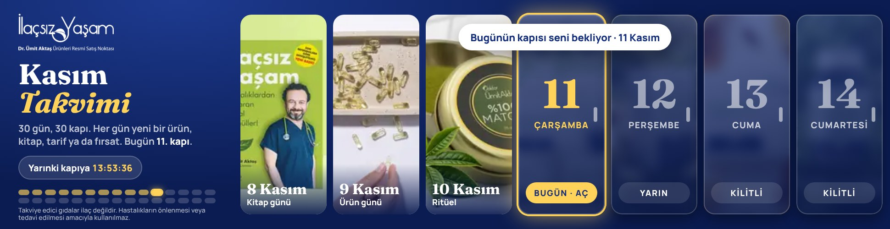 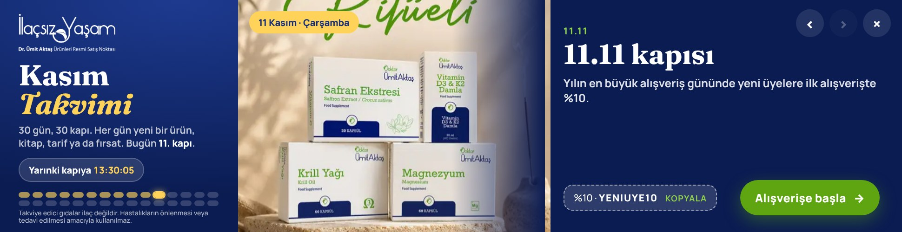 | 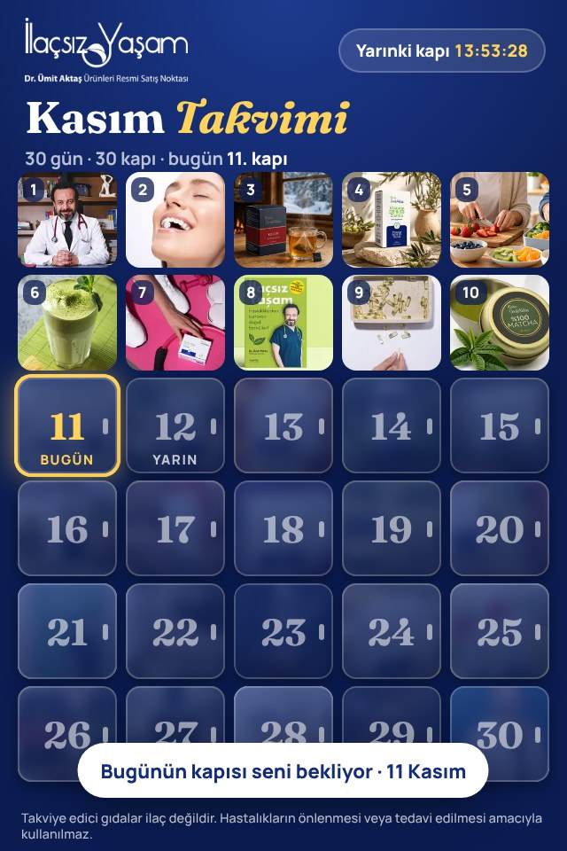 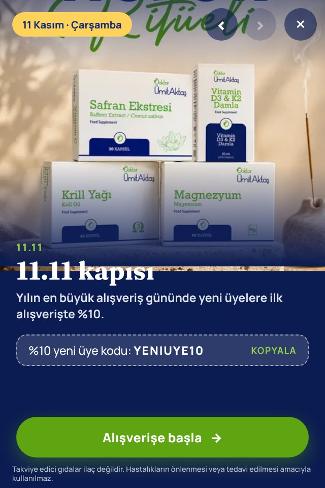 |

## 3D set — gerçek fotoğraflarla üç boyut (sunumda Çalışma 19–22)

Hepsi CSS 3D ile kurulur; yüzeylerin tamamı sitedeki gerçek ürün/an fotoğraflarıdır, çizim yoktur. Açılışta kendi kendine oynar, dokunulduğunda kontrol kullanıcıya geçer.

| Çalışma | Kaynak | Fikir |
|---|---|---|
| 3D Kasım Halkası · 970×250 | `rich/masthead-970x250-3d-halka.html` | Sekiz an (Sabah, Öğle, Akşam, Gece…) bir silindirde döner; sürükle ya da yandaki karta dokun, öndeki ürün sağda açılır. |
| 3D Kasım Küpü · 320×480 | `rich/mobil-320x480-3d-kup.html` | Altı yüzü altı ürün anı olan küp; yüzler dışarıdan gelip birleşir, parmakla her yöne çevrilir ve yüze oturur. |
| 3D Kasım Rutin Kitabı · 320×480 | `rich/mobil-320x480-3d-kitap.html` | Kapağı açılan, sayfaları sırttan 3B dönen bir kitap; her sayfa bir ürün, arka kapakta kupon. |
| 3D Kasım Galerisi · 320×480 | `rich/mobil-320x480-3d-tunel.html` | "Kasım galerisinde bir tur at": fotoğraflar koridorun iki yanında derinlikte dizilir, yukarı kaydırdıkça aralarında ilerlenir; sonda kupon kapısı. |

## Konuşan, yayılan, saati bilen — yeni set

| Çalışma | Boyut | Mekanik | Klasör |
|---|---|---|---|
| **İlaçsız Yaşam ile Mesajlaş** | 320 × 480 | Mesajlaşma ekranı; hazır sorular → onaylı cevaplar, ambalajdaki kullanım bilgisi, fotoğraflı ürün kartları, %10 kod | `dist-rich/mobil-320x480-sohbet/` |
| **Sevdiğine Bir Rutin Gönder** | 320 × 480 | Alıcı seç → gerçek fotoğraflı kartpostal → WhatsApp ile alıcıya özel UTM'li paylaşım; alıcıya %10 hoş geldin | `dist-rich/mobil-320x480-gonder/` |
| **Günün Rutini** | 970 × 250 | İzleyicinin yerel saatine göre sahne (sabah/öğle/akşamüstü/gece), canlı saat, gerçek gün doğumu/batımı, sürüklenebilir güneş | `dist-rich/masthead-970x250-saat/` |

- **WhatsApp paylaşımı:** Çıkış `Enabler.exitOverride` ile çalışır; ağ tek `clickTag` zorunlu kılıyorsa (Google Ads) paylaşım yerine clickTag açılır, bu çalışma rich media platformu (Studio/Celtra/Adform) için önerilir.
- **Saat önizleme:** `index.html?saat=21`.

| Mesajlaş | Gönder | Günün Rutini |
|---|---|---|
| 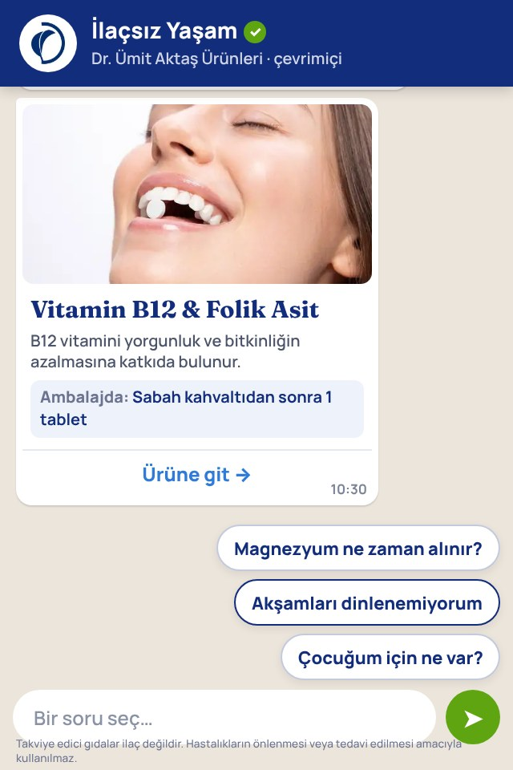 | 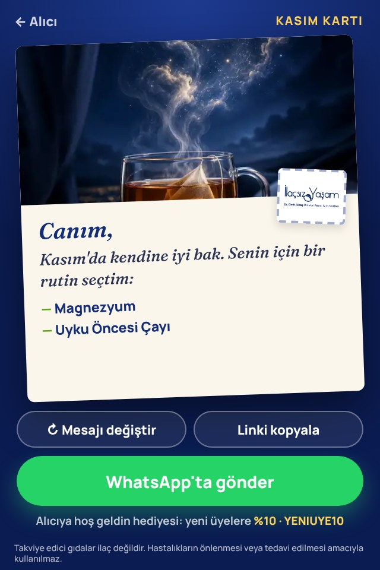 | 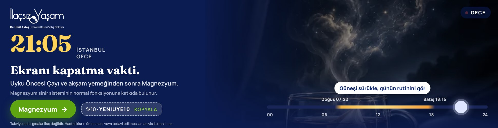 |

## Mobil'e özgü set — uygulama, kazı kazan, oyun (320 × 480)

| Çalışma | Mekanik | Klasör |
|---|---|---|
| **Rutin Eşleş** | Tanışma uygulaması: takviye profilleri (gerçek fotoğraf, biyografi, onaylı beyan), sağa/sola kaydırma damgaları, galeri, "Eşleştiniz!" + ilk buluşma hediyesi %10, gün sonu özeti | `dist-rich/mobil-320x480-eslesme/` |
| **Kasım Kazı Kazan** | Bal peteği fotoğrafı kaplamalı 6 pencere, parmakla kazıma, 3 D3 & K2 → "Kazandın!" + %10. Çekiliş değildir, her kart kazanır. | `dist-rich/mobil-320x480-kazikazan/` |
| **Bulutları Dağıt** | 20 sn dokunma oyunu: gri Kasım bulutlarını patlat, sahne aydınlanır; meyve/sebze balonları +3; skor, rekor, ürünler ve %10 | `dist-rich/mobil-320x480-oyun/` |

| Rutin Eşleş | Kazı Kazan | Bulutları Dağıt |
|---|---|---|
| 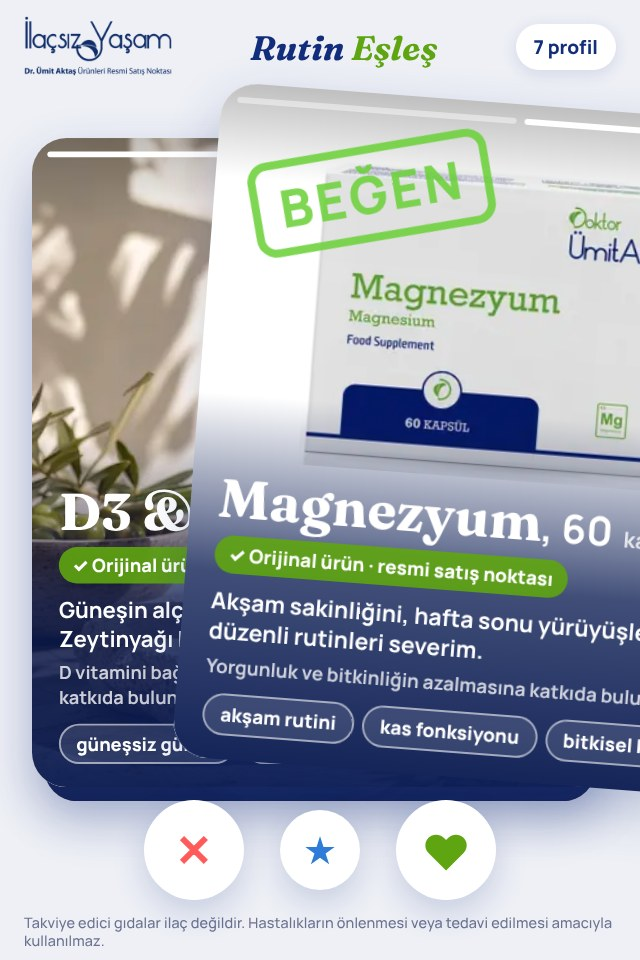 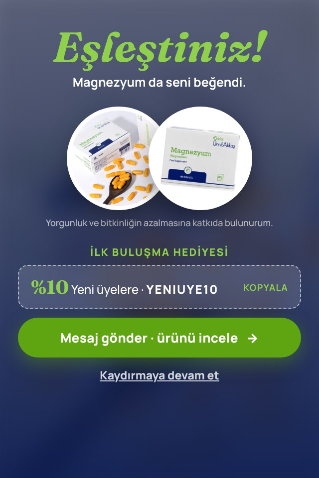 | 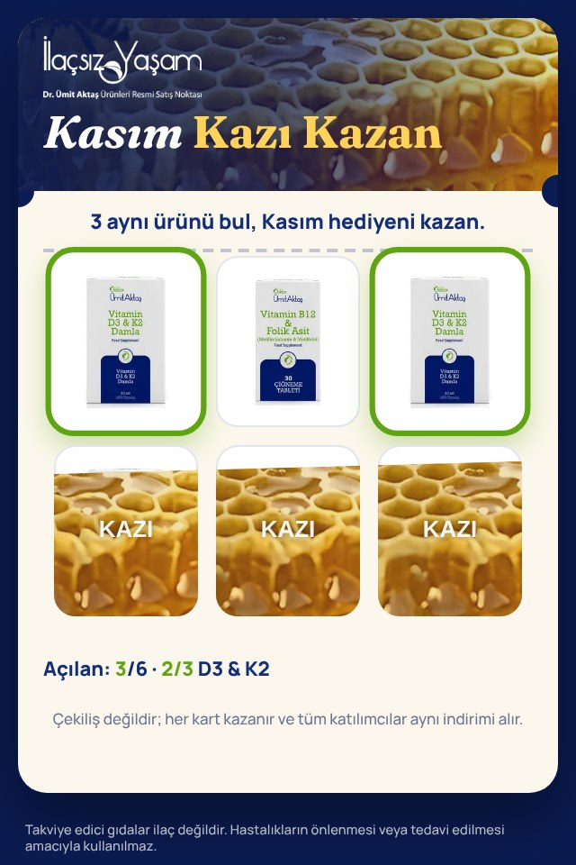 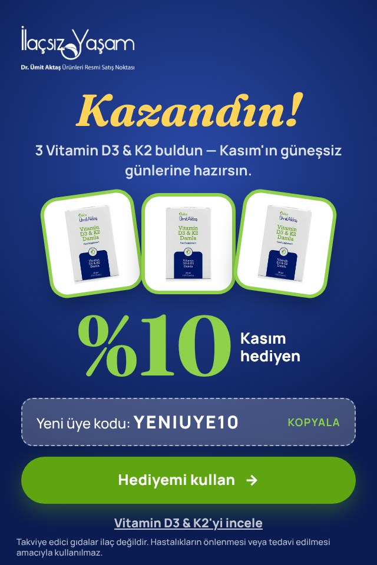 | 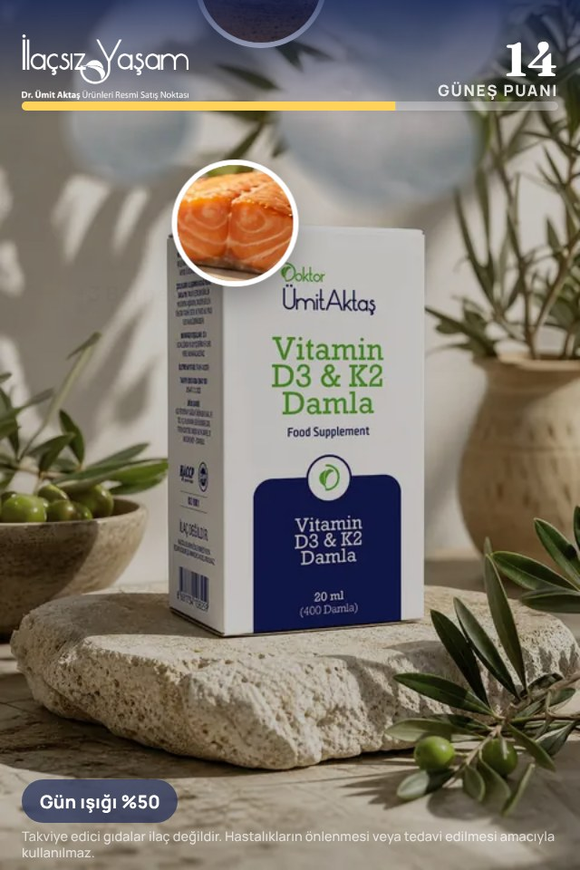 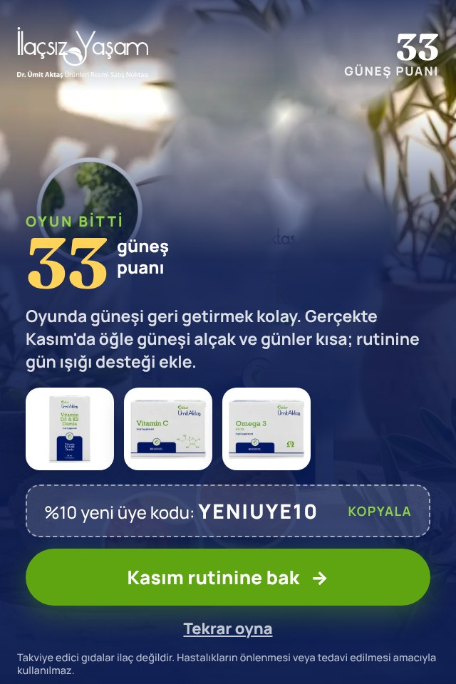 |

## Ana fikir — "Gölgen ne diyor?" (ihtiyacı ortaya çıkaran canlı veri)

Reklam, izleyicinin şehri ve bugünün tarihi için güneşi canlı hesaplar (`rich/gunes.js`, NOAA yaklaşımı, ±2 dk): *"Bugün İstanbul'da öğlen gölgen boyunun 1,7 katı."* Gölge boydan uzunsa güneş D vitamini üretimi için yeterince dik gelmez. Güneş kaydırıcısı Haziran → Aralık sürüklendikçe fotoğrafın ışığı söner, gün ışığı kaybı dakikasıyla yazılır. Ardından fotoğraflı 3 soru → kişisel Kasım rutini (2–3 ürün, onaylı beyanlar, %10 kod, "tıbbi tavsiye değildir" notu).

| Çalışma | Boyut | Klasör |
|---|---|---|
| Gölgen Ne Diyor? | 970 × 250 masthead | `dist-rich/masthead-970x250-golge/` |
| Gölgen Ne Diyor? (Mobil) | 320 × 480 | `dist-rich/mobil-320x480-golge/` |

- **Şehir:** Yayın makrosu ile `index.html?city=ankara` (istanbul, ankara, izmir, bursa, antalya, adana, konya); yoksa İstanbul, kullanıcı değiştirebilir.
- **İhtiyaç verisi:** Cevaplar sonuç adresinin `utm_content`'ine yazılır (`…_test_masa_cocuk_enerji`) ve `quiz_*` olayları sayılır → mecra/şehir bazında ihtiyaç dağılımı raporlanabilir.
- **Mesaj onayı:** "Gölge kuralı" bilgilendirme amaçlıdır; metin ve ürün eşleşmeleri yayın öncesi marka/regülasyon onayına sunulmalıdır.

| Masthead | Mobil |
|---|---|
| 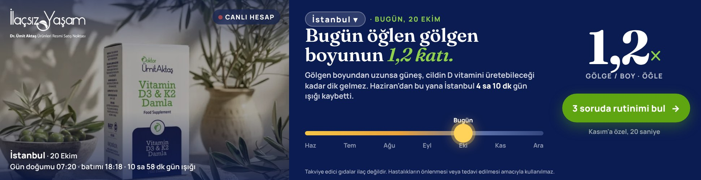 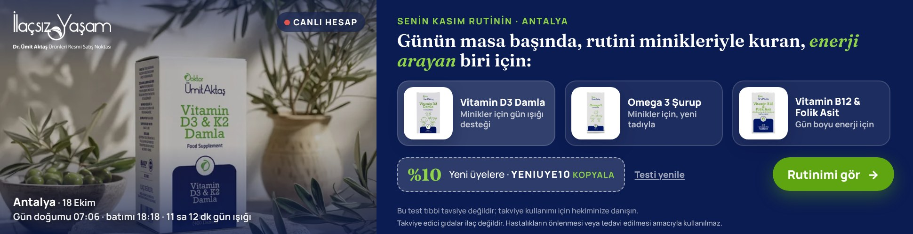 | 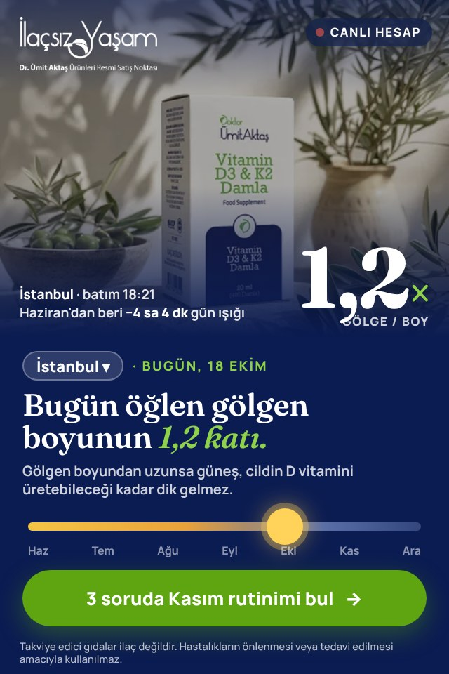 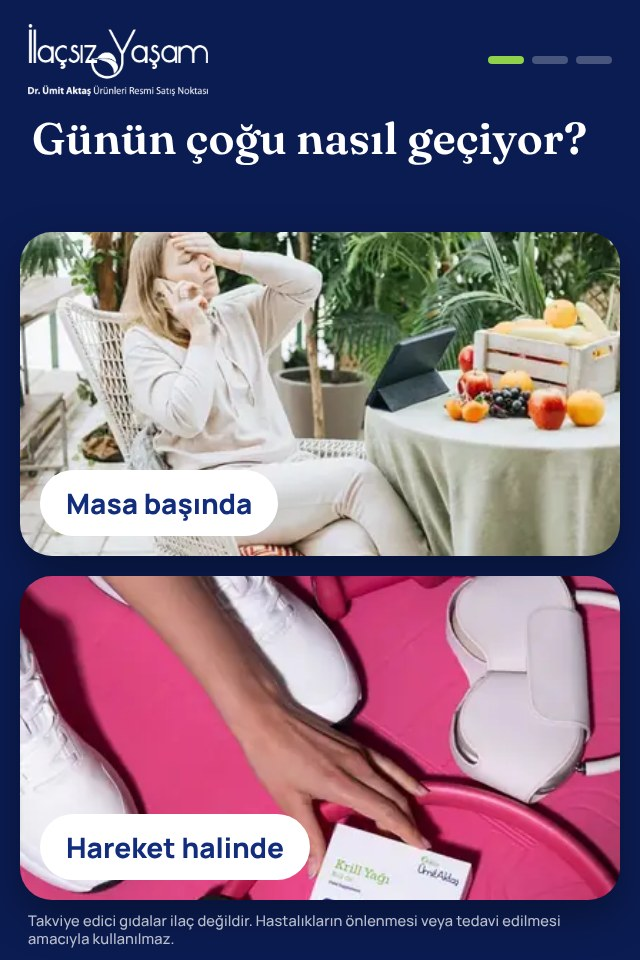 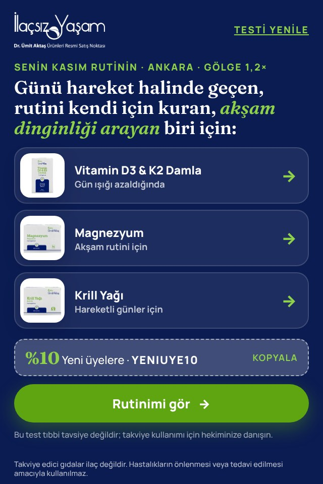 |

## Yaratıcı set — "Her anın arkasında bir rutin var."

| Çalışma | Boyut | Mekanik | Klasör |
|---|---|---|---|
| **Merceği Gezdir** | 970 × 250 masthead | Fare bir büyüteç olur; 4 gerçek anın (gri Kasım göğü, kahkaha, parkta çocuklar, pilates) üzerinde gezdikçe mercek altında o anın arkasındaki ürün sahnesi belirir. Kendi kendine tur, 4 keşif sayacı, keşifler tamamlanınca kupon parlar. | `dist-rich/masthead-970x250-mercek/` |
| **Merceği Gezdir (Mobil)** | 320 × 480 | 2×2 an, parmakla sürüklenen mercek, keşif sayacı, kalıcı kupon şeridi | `dist-rich/mobil-320x480-mercek/` |
| **Dr. Ümit Aktaş'ın Ofisi** | 320 × 480 | Markanın ofis fotoğrafında kaydırarak / telefonu eğerek (gyro) gezinme; fotoğraftaki gerçek nesneler sıcak nokta: kitaplık, yoga heykeli, stetoskop, oyuncak, kırmızı ajanda (%10). 5 sürpriz sayacı. | `dist-rich/mobil-320x480-ofis/` |
| **Rutin Eşleştir** | 320 × 480 | Gerçek fotoğraflarla hafıza oyunu: anı ürünüyle eşleştir; 3 eş → Dr. Ümit Aktaş'lı final ekranında %10 kod | `dist-rich/mobil-320x480-eslestir/` |

Ağırlıklar 90–135 KB. Otomatik akış < 30 sn; etkileşim yoksa mekaniği kendisi gösterir ve teklif ekranına ulaşır.

## Standart set (alternatif)

| Çalışma | Boyut | Mekanik | Klasör / zip |
|---|---|---|---|
| Rutin Seçici Akordeon | 970 × 250 masthead | Dr. Ümit Aktaş portreli marka paneli + 4 fotoğraf paneli; otomatik döner, üzerine gelince açılır, ürün ve segment derin bağlantıları | `dist-rich/masthead-970x250/` |
| Rutin Kartları | 320 × 480 mobil | Tam ekran fotoğraf kartları, parmakla kaydırma (story çubuğu), son kart %10 kupon | `dist-rich/mobil-320x480-kartlar/` |
| Sil & Keşfet | 320 × 480 mobil | Ürün fotoğrafını parmakla sil → Dr. Ümit Aktaş + %10 kupon; demo çizgisi, %45'te açılır, 12 sn'de otomatik açılır | `dist-rich/mobil-320x480-sil-kesfet/` |
| Rutin Seçici (Dikey) | 320 × 480 mobil | 4 fotoğraf şeridi dikey akordeon, kalıcı kupon şeridi | `dist-rich/mobil-320x480-rutin/` |

- **Görseller:** Tamamı ilacsizyasam.com'daki orijinal fotoğraflar (Dr. Ümit Aktaş portreleri, ürün yaşam tarzı çekimleri, ambalaj fotoğrafları). Çizim/SVG/vektör illüstrasyon yoktur. Arşiv `assets/media/` (GitHub Actions: `.github/workflows/fetch-media.yml`), kreatif kırpımları `assets/rich/` (`python3 tools/rich-assets.py`).
- **Segmentler:** Yetişkin (Günlük enerji), Bağışıklık (Kışa hazırlık), Çocuk & Aile (Miniklere destek), Aktif Yaşam (Spor & hareket). Sağlık beyanları onaylı beyan listesinden seçildi; yasal ibare her çalışmada var. Yayın öncesi marka/regülasyon onayı önerilir (özellikle hekim görselinin takviye reklamında kullanımı).
- **Session / yeni kullanıcı:** Her segment ve her ürün UTM'li ayrı adrese gider (`utm_campaign=kasim_2026`, `utm_content=<çalışma>_<segment>_<ürün>`); kupon `YENIUYE10` tek dokunuşla kopyalanır.
- **Tıklama:** `Enabler` varsa `Enabler.exitOverride(id, url)` (Studio/DV360, çoklu çıkış), `clickTag` tanımlıysa o (Google Ads / CM360), yoksa doğrudan UTM'li adres. Ölçüm olayları `AD.track()` → `Enabler.counter` (segment açma, kart kaydırma, kupon kopyalama, silme başlangıcı/açılma).
- **Kurallar:** Otomatik animasyon < 30 sn; `prefers-reduced-motion` desteklenir; ağırlık 134–203 KB (masthead 177 KB). Metinler `rich/data.js`, kreatifler `rich/*.html`.

```bash
python3 tools/rich-assets.py                           # assets/media → assets/rich (kırpma, WebP)
node tools/build-rich.js                               # dist-rich/ + zip + preview-rich/index.html
NODE_PATH=$(npm root -g) node tools/shoot-rich.js      # ekran görüntüleri + etkileşim testi
```

| Masthead (mercek) | Mobil (mercek · ofis · eşleştir) |
|---|---|
| 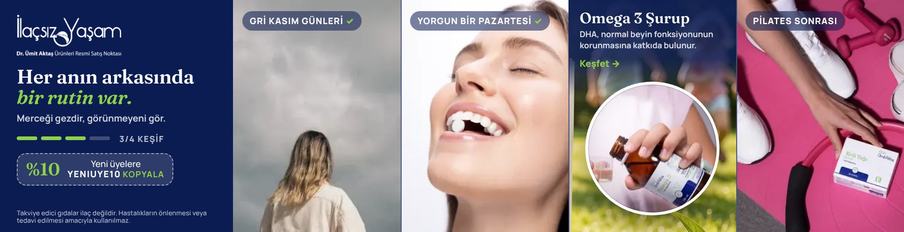 | 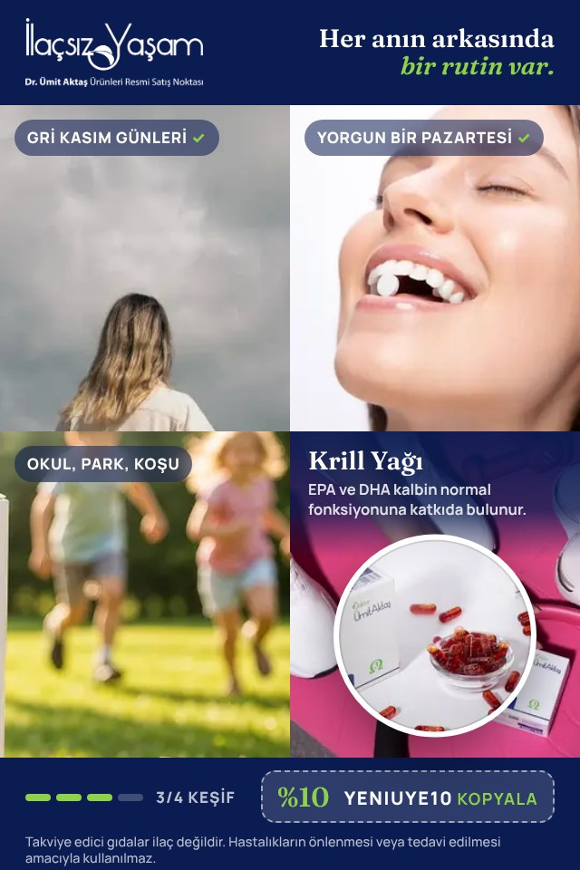 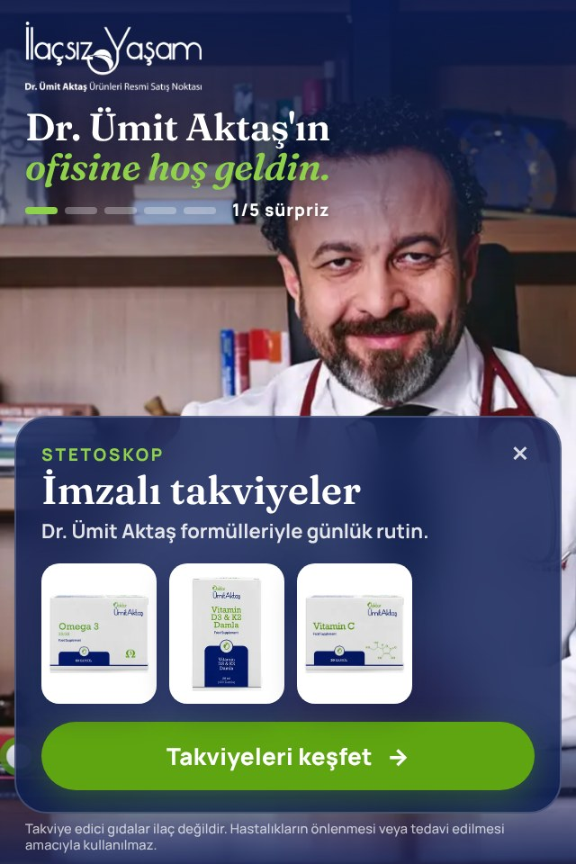 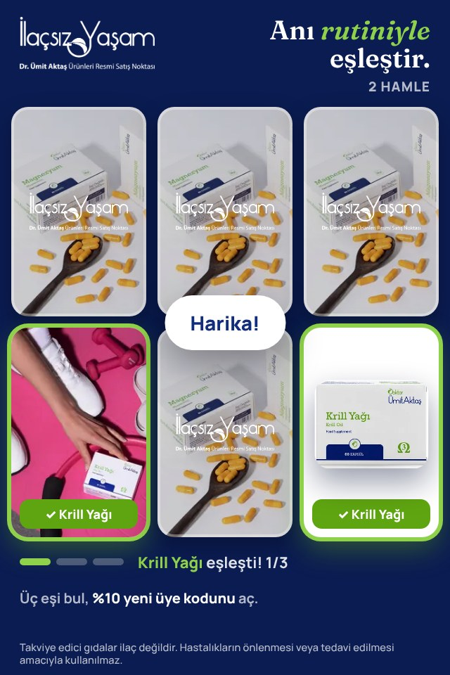 |

| Masthead (standart) | Mobil (standart) |
|---|---|
| 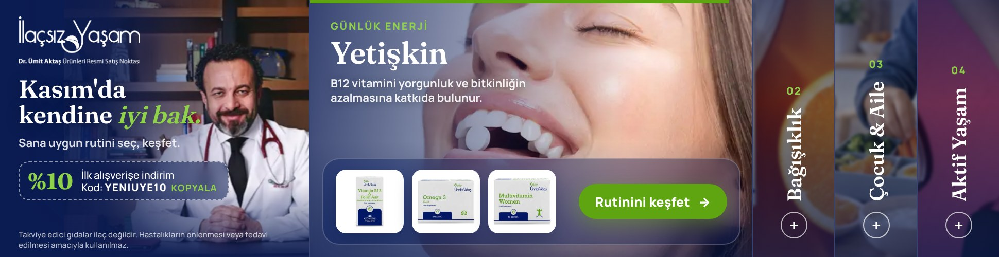 | 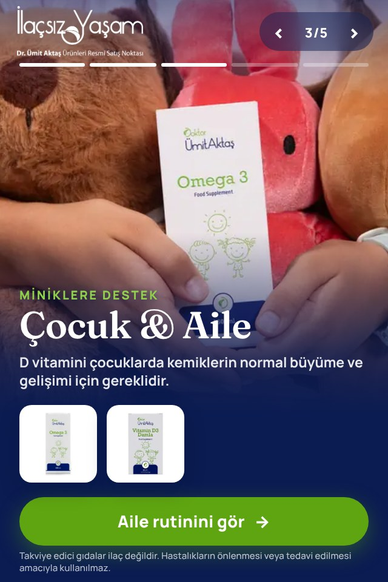 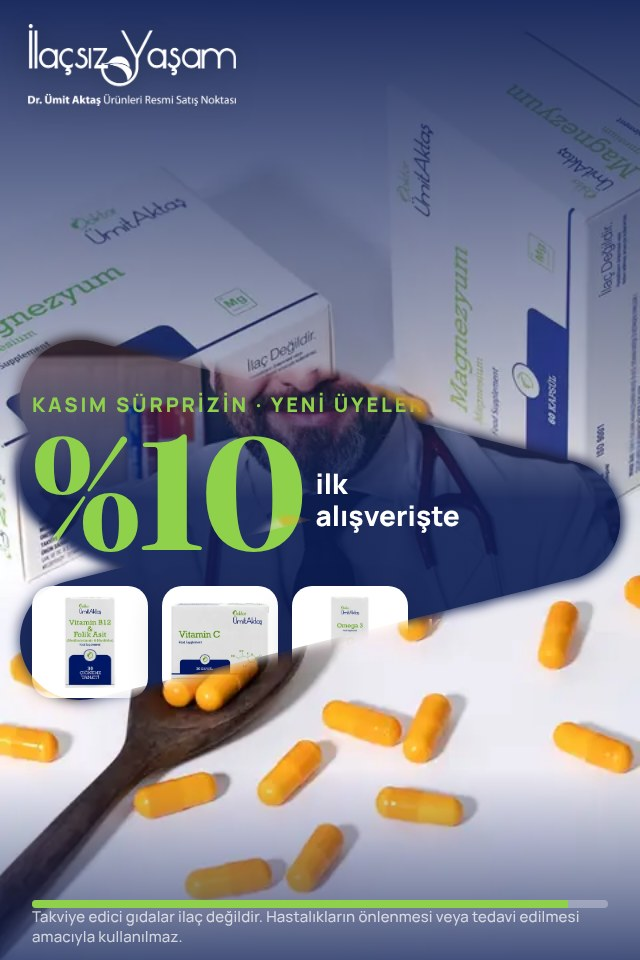 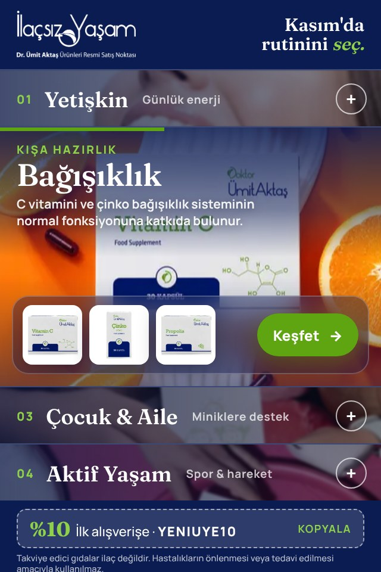 |

---

# İlaçsız Yaşam – Gıda Takviyesi Banner Serisi

[ilacsizyasam.com](https://ilacsizyasam.com/) için hazırlanmış, gıda takviyeleri özelinde **animasyonlu, ürün slider'lı ve tıklanabilir HTML5 display reklam seti**.

| Boyut | IAB adı | Dosya | Paket |
|---|---|---|---|
| 300 × 250 | Medium Rectangle | `dist/300x250/index.html` | `dist/zip/ilacsizyasam-300x250.zip` |
| 300 × 600 | Half Page | `dist/300x600/index.html` | `dist/zip/ilacsizyasam-300x600.zip` |
| 970 × 250 | Billboard | `dist/970x250/index.html` | `dist/zip/ilacsizyasam-970x250.zip` |

Tek dosyalık teslim: `release/index.html` (üç banner içine gömülü; açınca doğrudan animasyonlu çalışır, her bannerın kendi index.html'i sayfadan indirilir). Sunum sayfası: `preview/index.html` (üç boyutu bir arada gösterir; "Yayın simülasyonu" görünümü bannerları örnek bir haber sayfası içinde konumlandırır).

## Ekran görüntüleri

| 970 × 250 – ürün kartı | 970 × 250 – kapanış |
|---|---|
| 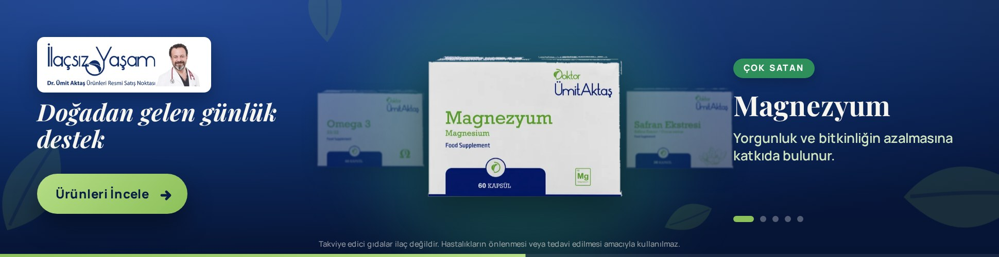 | 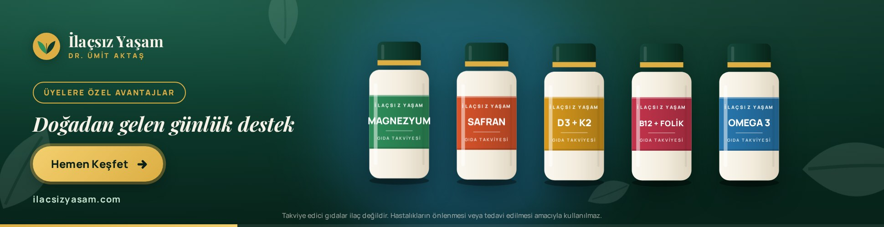 |

| 300 × 250 – açılış | 300 × 250 – ürün kartı | 300 × 250 – kapanış |
|---|---|---|
| 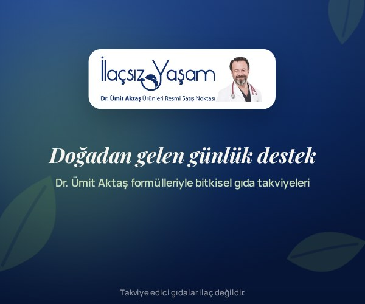 | 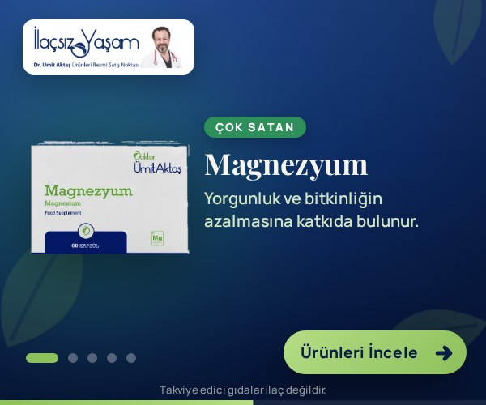 | 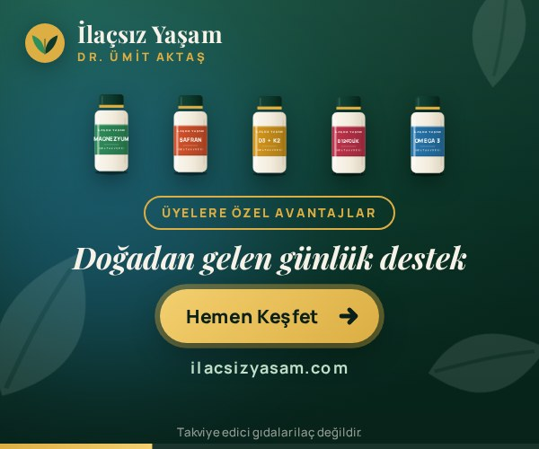 |

| 300 × 600 – ürün kartı | 300 × 600 – üzerine gelme | 300 × 600 – kapanış |
|---|---|---|
| 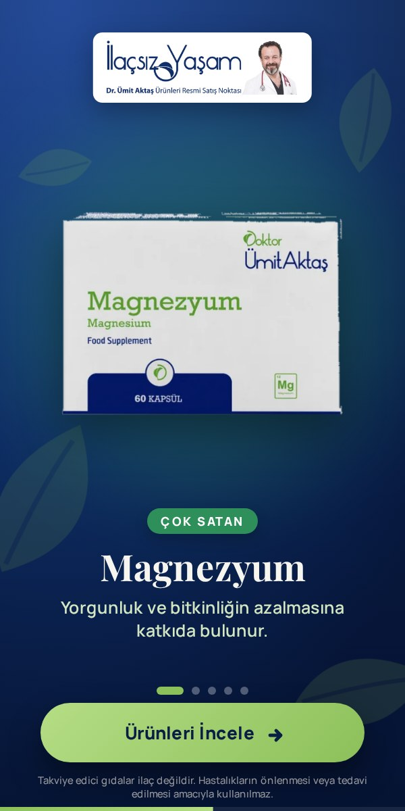 | 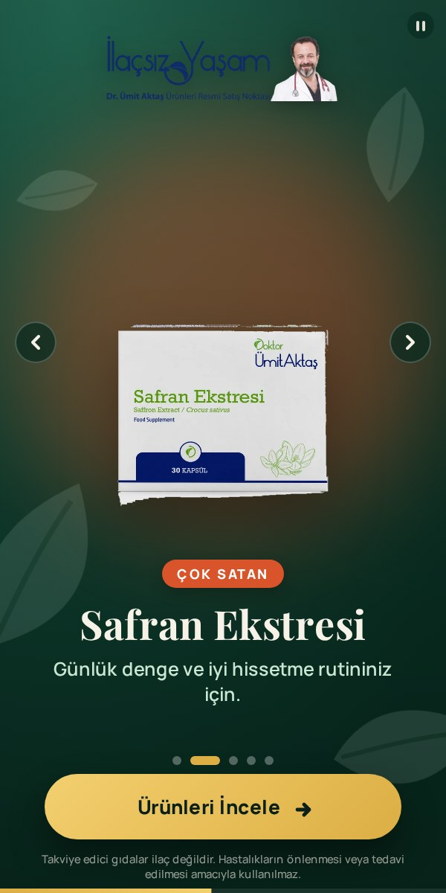 | 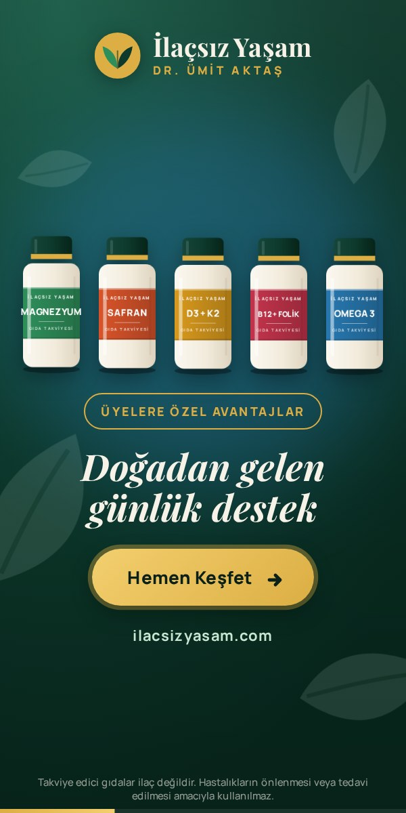 |

## Kurgu

1. **Açılış (2,6 sn)** – Logo ortada büyür, slogan ("GDO'SUZ · GLUTENSİZ / Vitrini keşfet, favorini seç! / Dr. Ümit Aktaş imzalı takviyeler") kelime kelime belirir, ardından logo köşeye küçülür.
2. **Ürün slider'ı (5 × 3,2 sn)** – Her ürünün orijinal ambalaj fotoğrafı yükselerek girer, rozet / ürün adı / fayda cümlesi sırayla gelir, arka plan ışığı ürün rengine döner. 970×250'de komşu ürünler kenarlarda gölge olarak görünür (coverflow).
3. **Kapanış (3,6 sn)** – Ürün ailesi tek karede sıralanır, slogan ve nabız efektli CTA gösterilir; kupon görünür kalır.
4. Döngü 30 saniyeye kadar sürer; sonra son karede (CTA) durur. Google Ads'in 30 sn animasyon kuralına uygundur.

### Yeni üye kuponu (%10)

Referans çalışmadaki indirim bölümü üç boyuta uyarlandı: 970×250'de sağda kırmızı kupon paneli, 300×600'de yatay kupon bileti, 300×250'de sağ üstte kompakt kupon çipi. Kod (`YENİUYE10`) tıklanınca panoya kopyalanır ve "Kopyalandı!" geri bildirimi verilir. Metinler, kod ve renkler `src/data.js` → `coupon` altında; `enabled: false` ile bölüm tamamen kaldırılır.

## Etkileşim

- **Üzerine gelme:** Slider duraklar, ileri/geri okları belirir, sağ üstte duraklatma göstergesi çıkar.
- **Noktalar ve oklar:** Ürünler arasında serbest gezinme.
- **Klavye:** Odaktayken ← → ile ürün değiştirme, Enter ile tıklama.
- **Mobil:** Sağa/sola kaydırma ile ürün değiştirme.
- **Kupon:** İndirim kodu tıklanınca panoya kopyalanır (Clipboard API, yoksa execCommand yedeği); kontrol tıklaması reklam çıkışını tetiklemez.
- **Tıklama:** Bannerın tamamı tıklanabilir. `window.clickTag` tanımlıysa o kullanılır (Google Ads / DCM), `Enabler` varsa `Enabler.exit` çağrılır (Studio / DV360); ikisi de yoksa `src/data.js` içindeki UTM'li ürün sayfası açılır. Kontroller (nokta, ok) tıklamayı yutar.
- `prefers-reduced-motion` açıksa animasyonlar kısaltılır.

## Teknik özellikler

- Tek dosya, satır içi CSS + JS; ürün fotoğrafları ve logo base64 olarak gömülü. Her boyut ~140 KB (Google Ads sınırı 150 KB); vektör modda ~30 KB.
- Tipografi: Google Fonts üzerinden *Playfair Display* (başlık) ve *Manrope* (metin). Google Fonts, Google Ads ve DV360'ta izinli kaynaktır. Harici font kabul etmeyen ağlar için `@font-face` ile gömülebilir (bkz. aşağıda).
- `<meta name="ad.size">` etiketi, `role="link"`, aria etiketleri ve klavye odağı mevcuttur.
- Yasal ibare ("Takviye edici gıdalar ilaç değildir…") üç boyutta da yer alır.
- Görseller: 5 ürünün sitedeki orijinal ambalaj fotoğrafları (şeffaflaştırılmış WebP) ve sitenin logosu.
- Ürün fayda cümleleri EFSA onaylı sağlık beyanlarına yaslanacak şekilde yumuşatılmıştır (magnezyum–yorgunluk, D vitamini–kemik/bağışıklık, B12–enerji metabolizması, EPA/DHA–kalp). Yayın öncesi markanın regülasyon onayı önerilir.

## Gerçek ürün görselleri ve logo (siteden otomatik)

Bannerlar iki modda derlenir:

- **Fotoğraf modu** – `assets/manifest.json` varsa sitedeki gerçek ürün fotoğrafları, logo ve ürün sayfası bağlantıları kullanılır (varsayılan).
- **Vektör modu** – `assets/` yoksa veya `node build.js --vector` denirse şablondaki çizim şişeler kullanılır.

Depodaki `assets/` klasörü ve `dist/` bannerları **sitedeki gerçek ürün fotoğrafları, logo ve fiyatlarla** derlenmiştir (kaynak: ilacsizyasam.com, Shopify). Görselleri güncellemenin iki yolu var:

**1. GitHub Actions (önerilen, kurulum gerektirmez):** Depoda *Actions* sekmesi → "Siteden görselleri çek ve derle" → *Run workflow*. İş akışı siteden güncel görselleri indirir, optimize eder, bannerları derler, ekran görüntülerini ve teslim zip'ini üretir ve sonucu dala push'lar (`.github/workflows/fetch-assets.yml`).

**2. Yerel bilgisayarda** (normal internet erişimi, Node 18+):

```bash
node tools/fetch-assets.js       # ilacsizyasam.com → assets/ (ürün fotoğrafları, logo, fiyatlar, ürün adresleri, tema renk adayları)
npm run optimize-assets          # (önerilir) beyaz fonu şeffaflaştırır, kırpar, küçültür, WebP'ye çevirir; koyu logoyu beyaza çevirmek üzere işaretler
node build.js                    # gerçek görsellerle derler; boyut 150 KB'ı aşarsa uyarır
```

- Ürün eşleştirmesi `src/data.js` içindeki `handle` alanıyla yapılır (`ilacsizyasam.com/products/<handle>`); handle bulunamazsa ürün adındaki kelimelerle başlık araması yapılır.
- `optimize-assets` adımı Playwright + Chromium ister (`npm i -D playwright && npx playwright install chromium`). Atlanırsa fotoğraflar indirildiği gibi (640 px JPEG) gömülür; sunum için yeterlidir, Google Ads için boyut sınırı aşılabilir.
- Arka planı düz beyaz olmayan fotoğraflar otomatik olarak krem renkli "kart" içinde gösterilir.
- Logo koyu renkliyse (İlaçsız Yaşam logosu lacivert) beyaz bir plaka üzerine alınır; tek renkli koyu logolar için `manifest.json` → `logo.invert: true` ile beyaza çevirme de mümkündür (`logo.plate: false` plakayı kapatır).
- Banner paleti sitenin kimliğine göre lacivert (#0e2e68) zemin + yeşil (#79a64e) vurgu olarak ayarlanmıştır; `src/template.js` içindeki `:root` değişkenleriyle değiştirilir.
- `brand.showPrice: true` yapılırsa ürün kartında güncel fiyat, `brand.deepLink: true` ise ürün kartındayken tıklama ilgili ürün sayfasına gider (clickTag tanımlıysa yine clickTag kullanılır).
- Görselleri elle eklemek isterseniz: `assets/products/<key>.png` ve `assets/logo.png` dosyalarını koyup `assets/manifest.json` içinde ilgili `file` alanlarını göstermeniz yeterlidir (örnek yapı için betiğin ürettiği manifest'e bakın).

> Not: Bu depo Claude Code'un yalıtılmış ortamında hazırlandı; o ortamın ağ politikası ilacsizyasam.com ve Shopify CDN'e erişime izin vermediği için görseller GitHub Actions üzerinden indirildi.

## Özelleştirme

Tüm metinler (slogan dahil), kupon, ürünler, renkler ve süreler tek dosyadadır: **`src/data.js`**.

```js
products: [
  { name: 'Magnezyum', short: 'MAGNEZYUM', claim: '…', badge: 'Çok Satan', color: '#2f8f5b', accent: '#bfe3cc' },
  // ürün ekleyin / sırasını değiştirin
]
```

Düzenledikten sonra:

```bash
node build.js          # dist/ altındaki 3 HTML + zip paketlerini yeniden üretir
node tools/package.js  # release/index.html (tek dosya) ve release/ilacsizyasam-banner-seti.zip üretir
npm run capture        # (isteğe bağlı) preview/screens/ altına ekran görüntüleri alır
npm run capture:video  # (isteğe bağlı) preview/video/ altına kısa kayıt alır
npm test               # (isteğe bağlı) etkileşim duman testi (Playwright)
```

`build.js` yalnızca Node.js ister; ek paket kurulumu gerekmez. `capture` komutları için Playwright + Chromium gerekir.

### Marka varlıklarını yerleştirme

- **Logo:** `src/template.js` içindeki `MARK` sabiti (yaprak işareti) resmi logonun SVG'siyle değiştirilebilir.
- **Ürün fotoğrafları:** `bottle()` fonksiyonu vektör şişe üretir. Gerçek ürün görselleri için bu fonksiyonun döndürdüğü SVG yerine `` verilebilir; ölçüler `--bw` değişkeniyle yönetilir.
- **Renkler:** `:root` altındaki `--forest`, `--gold`, `--mint`, `--cream` değişkenleri marka paletine göre ayarlanır.
- **Fontları gömme:** Ağ harici font kabul etmiyorsa Google Fonts `<link>` satırını kaldırıp `.woff2` dosyalarını base64 `@font-face` olarak `<style>` içine ekleyin (dosya boyutu ~120 KB'a çıkar, hâlâ sınır altındadır).

## Yükleme notları

- **Google Ads (HTML5):** `dist/zip/*.zip` dosyalarını doğrudan yükleyin. `ad.size` meta etiketi ve `clickTag` desteği hazırdır.
- **Campaign Manager 360 / DV360:** Aynı zipler kullanılabilir; `Enabler` algılanırsa çıkış `Enabler.exit('CTA')` üzerinden yapılır. Studio'ya yüklenecekse `<script src="https://s0.2mdn.net/ads/studio/Enabler.js"></script>` satırını `<head>` içine ekleyin.
- **Diğer ağlar (Adform, Xandr vb.):** Genellikle `clickTag` yeterlidir; ağın kendi makrosu farklıysa `openLink()` fonksiyonundaki `window.clickTag` satırı ilgili makroya çevrilir.

## Klasör yapısı

```
src/data.js              Marka metinleri, ürünler (handle), süreler
src/template.js          Ortak motor + 3 yerleşim (rect / tall / wide)
build.js                 dist/ üretici (fotoğraf / vektör modu)
assets/                  Siteden çekilen gerçek görseller + manifest.json
dist/<boyut>/            Yüklemeye hazır bannerlar
dist/zip/                Zip paketleri
release/                 Teslim: index.html (tek dosya) + zip
preview/index.html       Sunum sayfası
preview/screens/         Ekran görüntüleri
tools/fetch-assets.js    Siteden görsel/logo/fiyat çekme
tools/optimize-assets.js Görsel optimizasyonu (şeffaflaştırma, WebP)
tools/package.js         Teslim zip'i
tools/capture.js         Playwright ile görüntü/video alma
tools/smoke.js           Etkileşim duman testi
```
