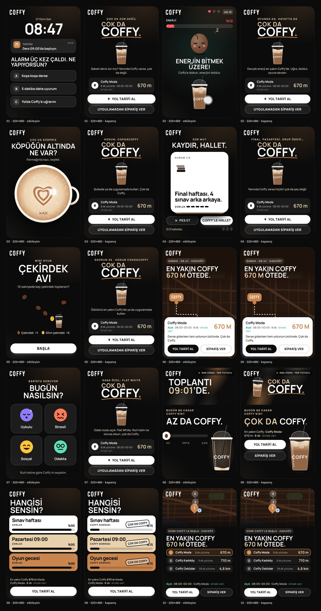
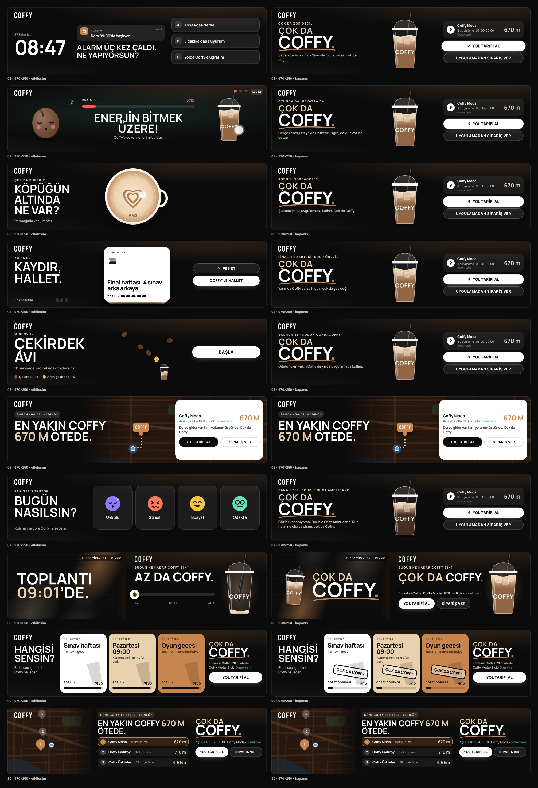

# Çok da Coffy – Lansman Planı ve 10 İnteraktif Çalışma

Coffy “Çok da Coffy” kampanyası için lansman/sürdürme planı ve **10 interaktif HTML5 çalışma**. Her çalışma **tek dosyadır ve hem 970×250 hem 320×480** alanında çalışır: alan genişliğine göre yerleşimini kendisi seçer (masaüstü billboard / mobil interstitial, oyun içi end card, playable).

- **Sunum:** `release/index.html` tek dosyadır. Splash Digital “Çalışmalar” şablonundaki gibi her çalışma tarayıcı penceresinde (970×250) ve telefon çerçevesinde (320×480) birlikte oynar. Ekrana gelince kendiliğinden başlar, “Tekrar oynat” ile baştan oynar.
- **Yükleme dosyaları:** `dist/<no>-<ad>/index.html` (iki boyut aynı dosyada) ve `dist/zip/*.zip`.
- **Plan:** [`LANSMAN-PLANI.md`](LANSMAN-PLANI.md).
- **Marka:** Logo `assets/logo-original.png` dosyasından alınmıştır (beyaz/siyah sürümler aynı klasörde). Kimlik siyah-beyaz, başlıklar logodaki gibi dar ve büyük harfli; vurgu rengi kahve tonudur.

| # | Çalışma | Mekanik |
|---|---|---|
| 01 | Saat Kaç? Senaryosu | Video → gerçek saate göre senaryo + 3 seçenek → bardak dolar → kapanış |
| 02 | Enerji Doldur | Ödüllü video → dokun-iç → enerji %100 → +1 Can |
| 03 | Köpüğü Kazı | Video → latte köpüğünü kazı → uygulama kodu |
| 04 | Zor mu? Kaydır. | Video → 3 “zor an” kartı, sağa kaydır = Coffy’le hallet |
| 05 | Çekirdek Avı | Video → 10 sn mini oyun → skor + kod |
| 06 | En Yakın Coffy | Video → harita, yürüme rotası, yol tarifi |
| 07 | Ruh Halin Ne? | Video → ruh hali seç → içecek önerisi |
| 08 | Coffy Seviyesi | Video + kaydırıcı: “Az da → Orta da → Çok da Coffy.” |
| 09 | Senaryonu Seç | Video → 3 senaryo paneli, zorluk %95 → %15 |
| 10 | Şube Bulucu | Video → haritada en yakın 3 şube |

## Ekran görüntüleri





## Ortak kurgu

**Ana video → soru / senaryo / oyun → Coffy tüketimiyle devam → “Çok da Coffy” → en yakın şube.**

- **Video:** Her çalışma ana videoyla açılır (6 sn’ye kadar, 2 sn sonra “Geç”). `src/config.js → video.src` boşken animasyonlu bir yer tutucu oynar. #08’de video interaksiyonla aynı karede döngüde oynar ve sesi açılabilir.
- **Otomatik demo:** Kullanıcı birkaç saniye etkileşmezse çalışma kendini oynatır ve bitiş kartına ulaşır. Her dokunuşta sayaç sıfırlanır.
- **Bitiş kartı:** “Çok da Coffy.” sloganı, en yakın şube (mesafe, yürüme süresi, saatler), **Yol tarifi al** ve **Uygulamadan sipariş** düğmeleri.
- **Dinamik metin:** #01, #06 ve #10 gün dilimine (sabah, öğle, akşam, gece) göre değişir. Önizlemede `?dp=morning|noon|evening|night` ve `?time=08:47` ile denenebilir.
- **Konum:** Sırasıyla MRAID `getLocation()` (uygulama içi), DSP makroları (`geo.latMacro/lonMacro`), `?lat=&lon=` parametresi ve son olarak varsayılan bölge kullanılır. En yakın şube haversine mesafesiyle hesaplanır.

## Teknik

- Her çalışma tek dosya (satır içi CSS/JS, logo gömülü) ve **~45 KB** (Google Ads sınırı 150 KB). Fontlar Google Fonts’tan gelir (*Barlow Condensed* + *Manrope*).
- **Tıklama:** Yalnızca CTA butonları (Yol tarifi al, Sipariş ver) dışarı çıkar; logo, zemin ve oyun alanı tıklaması çıkış yapmaz. Adreslerde UTM yoktur.
- **Çıkışlar:** `window.clickTag` tanımlıysa o kullanılır (Google Ads / CM360). `Enabler` varsa `Enabler.exitOverride(<ad>, url)` çağrılır (Studio; çıkış adları `app`, `directions`, `stores`). MRAID varsa `mraid.open` kullanılır. Hiçbiri yoksa `config.exits` adresleri açılır.
- **Ölçüm:** Etkileşimler `track()` ile `Enabler.counter`’a ve üst pencereye (`postMessage`) gönderilir. Sunum sayfası her kartın altında bu olayları canlı gösterir.
- `prefers-reduced-motion` desteklenir; düğmeler klavyeyle odaklanabilir.

## Güncellenecek yer tutucular

`src/config.js` dosyasında:

| Alan | Şu an | Yapılacak |
|---|---|---|
| `brand.logo` | Gönderilen logo (`assets/logo-white.png`) | Vektör (SVG) logo gelirse `brand.logoSvg` |
| Ürün görseli | Çizim bardak | Orijinal ürün fotoğrafları (coffy.com.tr) |
| `:root` renkleri (`src/base.css`) | Siyah / beyaz / kahve vurgusu | Kurumsal renk kodları |
| `video.src`, `video.poster` | Animasyonlu yer tutucu | CDN’deki 6 sn kesit |
| `stores` (`storesSample: true`) | 8 örnek şube | Coffy şube feed’i; `storesSample: false` yapılınca “örnek şube verisi” etiketi kalkar |
| `offer` | `COKDACOFFY` örnek kod | Gerçek teklif ve kanal bazlı kodlar |
| `drinks` | Örnek içecek adları | Güncel menü |
| `exits` | coffy.com.tr (UTM yok) | Uygulama derin bağlantısı / kampanya sayfası |

## Derleme

```bash
node coffy/build.js           # dist/ (10 çalışma, iki boyut tek dosyada) + zip'ler (Node 18+)
node coffy/tools/present.js   # release/index.html (Splash Digital şablonu) + release/cok-da-coffy-calismalar.zip
node coffy/tools/capture.js   # (isteğe bağlı) preview/screens/ – iki boyutta ekran görüntüleri (Playwright)
node coffy/tools/smoke.js     # (isteğe bağlı) 10 çalışma × 2 boyut etkileşim testi
```

## Klasör yapısı

```
coffy/
  LANSMAN-PLANI.md         Lansman ve sürdürme planı
  assets/                  Coffy logosu (orijinal, beyaz, siyah, blok) ve Splash Digital logosu
  src/config.js            Metinler, video, teklif, çıkışlar, şube verisi
  src/base.css             Ortak stil (renk değişkenleri, iki boyut için kapanış kartı)
  src/engine.js            Ortak motor: boyut algılama, video, konum, çıkış, ölçüm, kapanış kartı
  src/shared.js            Bardak çizimi ve sayfa şablonu
  src/concepts-mobile.js   01–07
  src/concepts-wide.js     08–10
  build.js                 Derleyici
  dist/                    Yüklemeye hazır çalışmalar + zip'ler
  release/                 index.html (sunum) + teslim zip'i
  tools/                   Sunum, ekran görüntüsü ve duman testi
```
