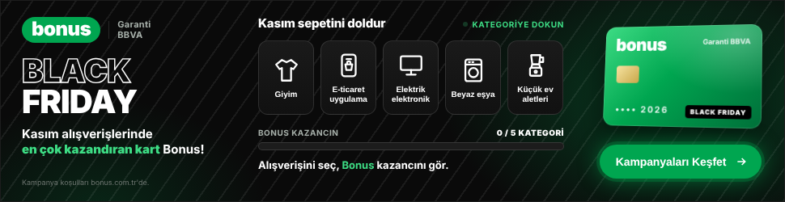
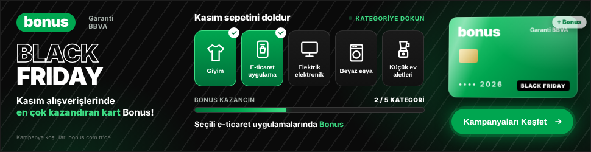
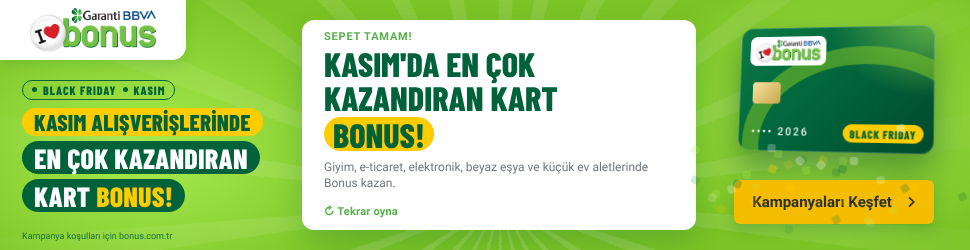
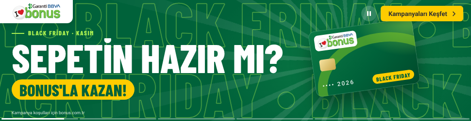
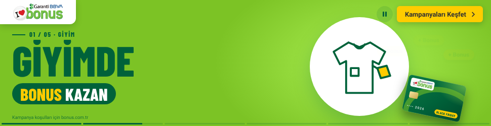
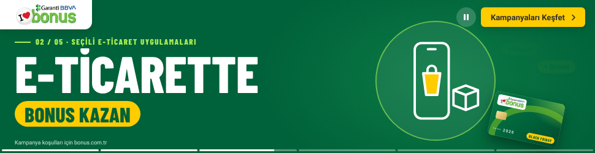
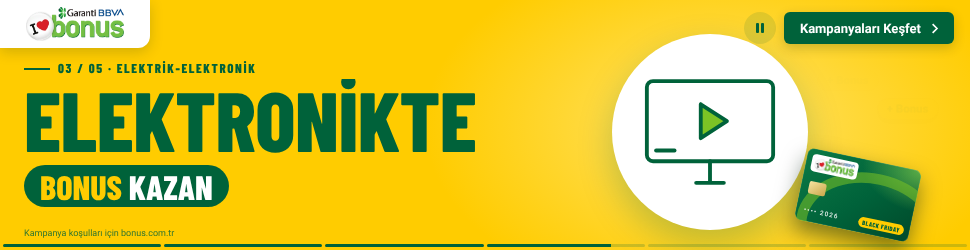
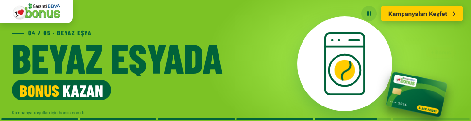
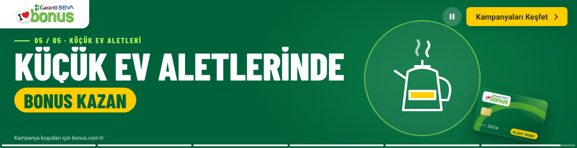
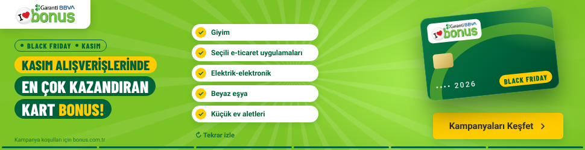

# Garanti BBVA Bonus – Black Friday İnteraktif Masthead (970 × 250)

Ana mesaj: **"Black Friday / Kasım alışverişlerinde en çok kazandıran kart Bonus"**

Teslim dosyası: `index.html` (tek dosya, satır içi CSS + JS, resmi Bonus logosu base64 gömülü, ~45 KB – Google Ads 150 KB sınırının altında).
Kaynak: `src/index.html` → `node build.js` ile `index.html` üretilir.

## Marka teması
Renkler, fontlar ve logo **garantibbva.com.tr** ve **bonus.com.tr**'den ölçüldü (`brand-ref/`: ekran görüntüleri, `report.json`; GitHub Actions → *Garanti BBVA / Bonus marka referansı* iş akışı ile yeniden toplanabilir).

| Rol | Renk | Kaynak |
|---|---|---|
| Zemin (Bonus kampanya yeşili) | `#7CC325`, ışık `#AAEF51` | bonus.com.tr kampanya görselleri |
| Başlık / koyu yeşil | `#00623A` | bonus.com.tr başlıkları |
| Buton / link yeşili | `#58B04C` | bonus.com.tr butonları |
| CTA sarısı | `#FFCC00` (metin `#2E3033`) | bonus.com.tr "Hemen Başvur / Şimdi Keşfet" |
| Metin | `#333333`, ikincil `#737980` | bonus.com.tr |

- Logo: bonus.com.tr'deki resmi "I ♥ bonus / Garanti BBVA" logosu (`assets/bonus-logo.webp`), sitedeki gibi beyaz sekme üzerinde.
- Tipografi: bonus.com.tr gövde fontu **Roboto**; kampanya görsellerindeki yoğun, dar başlık stili için **Barlow Condensed** (ikisi de Google Fonts). Ajansın elinde Bonus kampanya başlık fontu varsa `.cond` sınıfında değiştirilmeli.
- Başlıklar Bonus kampanya görsellerindeki gibi sarı / koyu yeşil "hap" kutular içinde; CTA sarı, 6 px köşe.

| Açılış | Sepet doluyor | Final |
|---|---|---|
|  |  |  |

## Kurgu
1. **Açılış (0–2 sn):** Beyaz sekmede Bonus logosu iner, "BLACK FRIDAY · KASIM" etiketi ve "Kasım alışverişlerinde / En çok kazandıran / kart Bonus!" başlık kutuları sırayla gelir, Bonus kartı sağdan girer, oyun paneli ve kategori kutuları yükselir. Zeminde Bonus görsellerindeki gibi yavaş dönen ışık hüzmeleri.
2. **"Kasım sepetini doldur" oyunu:** Kampanya kapsamındaki 5 kategori (Giyim, seçili e-ticaret uygulamaları, elektrik-elektronik, beyaz eşya, küçük ev aletleri). Kullanıcı kategoriye dokununca ikon karta uçar, kart parlar, "+ Bonus" rozeti çıkar, kazanç çubuğu dolar ve kategoriye özel mesaj gösterilir.
3. **Final:** 5 kategori dolunca "Kasım'da en çok kazandıran kart Bonus" karesi, konfeti ve nabız efektli CTA ("Kampanyaları Keşfet"). "Tekrar oyna" ile baştan başlar.

## Etkileşim
- Kullanıcı etkileşmezse kategoriler otomatik dolar (~1,7 sn arayla); yarıda bırakırsa 5 sn sonra otomatik devam eder. Animasyon 30 sn içinde finalde durur (Google Ads kuralı).
- Fare hareketiyle kartta 3B eğim; banner üzerine gelince CTA yeşile döner.
- Kategori düğmeleri ve "Tekrar oyna" tıklama çıkışını tetiklemez; geri kalan her alan tıklanabilir.
- Tıklama: `window.clickTag` (Google Ads / DCM) veya `Enabler.exit` (Studio / DV360). Varsayılan hedef `https://www.bonus.com.tr/kampanyalar` – yayın öncesi kampanya URL'si ile değiştirin.
- Klavye erişimi (Tab, Enter), `aria` etiketleri, `prefers-reduced-motion` desteği.

## Yayın öncesi yapılacaklar
- Logo ve renkler siteden alındı; yayın öncesi marka ekibinin onayından geçmeli (renkler `src/index.html` → `:root`).
- Kampanyada oran/tutar verilmediği için bonus miktarı yazılmadı; net kazanım oranları gelince `CATS[].msg` metinlerine eklenebilir.
- Yasal ibare ("Kampanya koşulları bonus.com.tr'de.") hukuk onayına göre güncellenmeli.

---

# Alternatif konsept: Media-First (sinematik) masthead

Teslim dosyası: `media-first/index.html` (tek dosya, ~52 KB). Kaynak: `src/media-first.html`.

| Açılış | Giyim | E-ticaret | Elektronik |
|---|---|---|---|
|  |  |  |  |

| Beyaz eşya | Küçük ev aletleri | Final |
|---|---|---|
|  |  |  |

**Kurgu (~16 sn, sonra finalde durur):** Banner bir video gibi akar. Açılışta koyu yeşil zeminde iki ters yönde kayan "BLACK FRIDAY" şeridi, "Sepetin hazır mı? / Bonus'la kazan!" ve sağdan dönerek giren Bonus kartı. Ardından 5 kategori sahnesi; her biri Bonus renklerinden birinde (yeşil → koyu yeşil → sarı …), kartın arkasından dairesel perdeyle açılır. Dev başlık maskeden yükselir, kategori illüstrasyonu çizilerek gelir (çamaşır makinesinin tamburu döner, su ısıtıcısından buhar çıkar), kart köşeye yerleşir ve "+ Bonus" rozetleri patlar. Finalde kart dönerek büyür, 5 kategori tek tek işaretlenir, sarı CTA nabız atar.

**Etkileşim:** Altta hikâye tarzı bölüm çubuğu (her bölüme tıklanır, üzerine gelince adı görünür) · üzerine gelince otomatik duraklar, sağ üstte oynat/duraklat · ← → tuşları ve mobilde kaydırma ile sahne değiştirme · kart fareyle 3B eğilir · "Tekrar izle".

**Film yuvası:** Kampanya filmi hazır olunca dosyanın başındaki `VIDEO_URL` değişkenine MP4 adresi yazılırsa açılış sahnesinin yerine sessiz video oynar (ses düğmesiyle), film bitince kategori sahneleri ve final devam eder.
