# Garanti BBVA Bonus – Black Friday İnteraktif Masthead (970 × 250)

Ana mesaj: **"Black Friday / Kasım alışverişlerinde en çok kazandıran kart Bonus"**

Teslim dosyası: `index.html` (tek dosya, satır içi CSS + JS, resmi Bonus logosu base64 gömülü, ~45 KB – Google Ads 150 KB sınırının altında).
Kaynak: `src/index.html` → `node build.js` ile `index.html` üretilir.

## Marka teması
Renkler, fontlar ve logo **garantibbva.com.tr** ve **bonus.com.tr**'den ölçüldü (`brand-ref/`: ekran görüntüleri, `report.json`; GitHub Actions → *Garanti BBVA / Bonus marka referansı* iş akışı ile yeniden toplanabilir).

| Rol | Renk | Kaynak |
|---|---|---|
| Zemin (Bonus kampanya yeşili) | `#7CC325`, ışık `#AAEF51` | bonus.com.tr kampanya görselleri |
| Başlık / koyu yeşil | `#00623A` | bonus.com.tr başlıkları |
| Buton / link yeşili | `#58B04C` | bonus.com.tr butonları |
| CTA sarısı | `#FFCC00` (metin `#2E3033`) | bonus.com.tr "Hemen Başvur / Şimdi Keşfet" |
| Metin | `#333333`, ikincil `#737980` | bonus.com.tr |

- Logo: bonus.com.tr'deki resmi "I ♥ bonus / Garanti BBVA" logosu (`assets/bonus-logo.webp`), sitedeki gibi beyaz sekme üzerinde.
- Tipografi: bonus.com.tr gövde fontu **Roboto**; kampanya görsellerindeki yoğun, dar başlık stili için **Barlow Condensed** (ikisi de Google Fonts). Ajansın elinde Bonus kampanya başlık fontu varsa `.cond` sınıfında değiştirilmeli.
- Başlıklar Bonus kampanya görsellerindeki gibi sarı / koyu yeşil "hap" kutular içinde; CTA sarı, 6 px köşe.

| Açılış | Sepet doluyor | Final |
|---|---|---|
|  |  |  |

## Kurgu
1. **Açılış (0–2 sn):** Beyaz sekmede Bonus logosu iner, "BLACK FRIDAY · KASIM" etiketi ve "Kasım alışverişlerinde / En çok kazandıran / kart Bonus!" başlık kutuları sırayla gelir, Bonus kartı sağdan girer, oyun paneli ve kategori kutuları yükselir. Zeminde Bonus görsellerindeki gibi yavaş dönen ışık hüzmeleri.
2. **"Kasım sepetini doldur" oyunu:** Kampanya kapsamındaki 5 kategori (Giyim, seçili e-ticaret uygulamaları, elektrik-elektronik, beyaz eşya, küçük ev aletleri). Kullanıcı kategoriye dokununca ikon karta uçar, kart parlar, "+ Bonus" rozeti çıkar, kazanç çubuğu dolar ve kategoriye özel mesaj gösterilir.
3. **Final:** 5 kategori dolunca "Kasım'da en çok kazandıran kart Bonus" karesi, konfeti ve nabız efektli CTA ("Kampanyaları Keşfet"). "Tekrar oyna" ile baştan başlar.
   - **Video alanı:** Final panelinde metnin yanında küçük bir 16:9 video penceresi (168 × 95) var. Dosyanın başındaki `VIDEO_URL`'e kampanya filminin MP4 adresi yazılırsa final karesi gelince film sessiz başlar (oynat/duraklat, sarma, ses, tam ekran); boşken "Kampanya filmi" yer tutucusu görünür. Video alanına tıklamak reklamdan çıkış yapmaz; film bitince CTA tekrar nabız atar.

   | Final – video alanı (boş) | Final – film oynuyor (test videosu) |
   |---|---|
   | 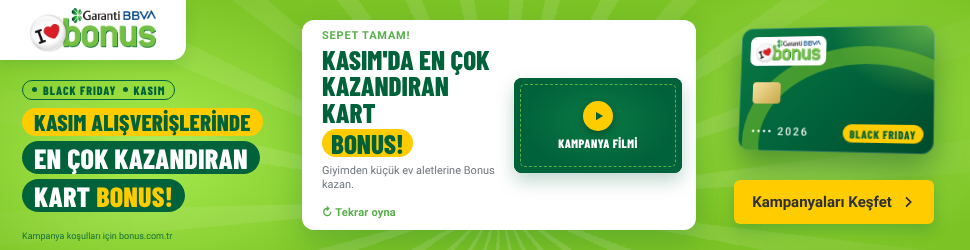 | 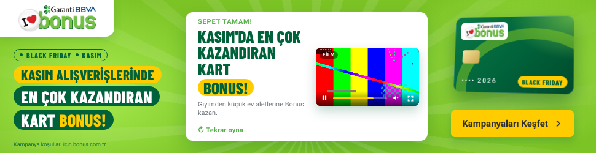 |

## Etkileşim
- Kullanıcı etkileşmezse kategoriler otomatik dolar (~1,7 sn arayla); yarıda bırakırsa 5 sn sonra otomatik devam eder. Animasyon 30 sn içinde finalde durur (Google Ads kuralı).
- Fare hareketiyle kartta 3B eğim; banner üzerine gelince CTA yeşile döner.
- Kategori düğmeleri ve "Tekrar oyna" tıklama çıkışını tetiklemez; geri kalan her alan tıklanabilir.
- Tıklama: `window.clickTag` (Google Ads / DCM) veya `Enabler.exit` (Studio / DV360). Varsayılan hedef `https://www.bonus.com.tr/kampanyalar` – yayın öncesi kampanya URL'si ile değiştirin.
- Klavye erişimi (Tab, Enter), `aria` etiketleri, `prefers-reduced-motion` desteği.

## Yayın öncesi yapılacaklar
- Logo ve renkler siteden alındı; yayın öncesi marka ekibinin onayından geçmeli (renkler `src/index.html` → `:root`).
- Kampanyada oran/tutar verilmediği için bonus miktarı yazılmadı; net kazanım oranları gelince `CATS[].msg` metinlerine eklenebilir.
- Yasal ibare ("Kampanya koşulları bonus.com.tr'de.") hukuk onayına göre güncellenmeli.

---

# Alternatif konsept: Media-First (sinematik) masthead

Teslim dosyası: `media-first/index.html` (tek dosya, ~52 KB). Kaynak: `src/media-first.html`.

| Açılış | Giyim | E-ticaret | Elektronik |
|---|---|---|---|
|  |  |  |  |

| Beyaz eşya | Küçük ev aletleri | Final |
|---|---|---|
|  |  |  |

**Kurgu (~16 sn, sonra finalde durur):** Banner bir video gibi akar. Açılışta koyu yeşil zeminde iki ters yönde kayan "BLACK FRIDAY" şeridi, "Sepetin hazır mı? / Bonus'la kazan!" ve sağdan dönerek giren Bonus kartı. Ardından 5 kategori sahnesi; her biri Bonus renklerinden birinde (yeşil → koyu yeşil → sarı …), kartın arkasından dairesel perdeyle açılır. Dev başlık maskeden yükselir, kategori illüstrasyonu çizilerek gelir (çamaşır makinesinin tamburu döner, su ısıtıcısından buhar çıkar), kart köşeye yerleşir ve "+ Bonus" rozetleri patlar. Finalde kart dönerek büyür, ortadaki **video penceresinde kampanya filmi** sessiz başlar, sarı CTA nabız atar.

**Etkileşim:** Altta hikâye tarzı bölüm çubuğu (her bölüme tıklanır, üzerine gelince adı görünür) · üzerine gelince otomatik duraklar, sağ üstte oynat/duraklat · ← → tuşları ve mobilde kaydırma ile sahne değiştirme · kart fareyle 3B eğilir · "Tekrar izle".

**Final karesindeki video penceresi (16:9, 320×180):**
- Dosyanın başındaki `VIDEO_URL` değişkenine kampanya filminin MP4 adresi (H.264, önerilen ≤15 sn, 640×360) yazılır. Final karesi gelince film **sessiz** başlar.
- Oynatıcı kontrolleri: oynat/duraklat, ilerleme çubuğu (tıklayarak sarma), süre, ses aç/kapat, tam ekran; duraklatınca ortada sarı büyük oynat düğmesi. Pencereye tıklamak reklamdan çıkış yapmaz.
- Film bitince oynatıcı durur ve CTA tekrar nabız atar.
- `VIDEO_URL` boşken pencerede aynı oynatıcı arayüzüyle 5 kategorinin önizleme döngüsü oynar (2 tur, sonra durur) – sunumda film yerini gösterir.
- İsteğe bağlı `INTRO_VIDEO_URL`: açılış sahnesi yerine tam ekran sessiz film oynatır.

| Final – film oynuyor | Final – duraklatıldı |
|---|---|
|  | 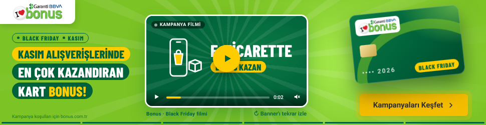 |

---

# Video masthead: kampanya görseli + video alanı

Teslim dosyası: `video/index.html` (tek dosya, ~38 KB). Kaynak: `src/video.html`.

| Video alanı boş (yer tutucu) | Film eklendiğinde (test videosu) |
|---|---|
| 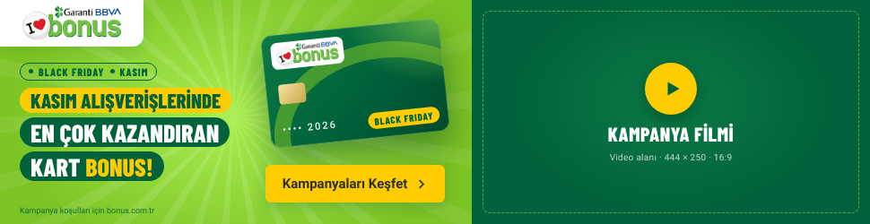 | 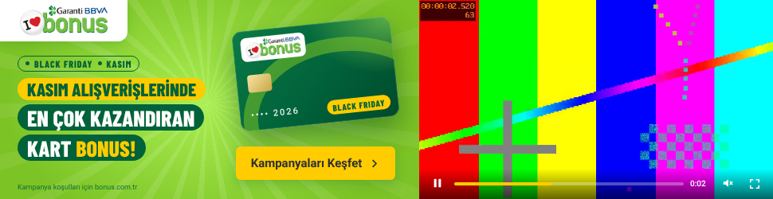 |

**Yerleşim**
- **Sol 526 × 250 – kampanya görseli:** logo, "Black Friday · Kasım" etiketi, ana mesaj, Bonus kartı, "Kampanyaları Keşfet" CTA'sı, yasal ibare. Ajansın hazırlayacağı kampanya görseli bu alanın yerine konabilir (`.kv` bloğu).
- **Sağ 444 × 250 – video alanı (16:9):** `VIDEO_URL` boşken kesik çizgili "Kampanya filmi" yer tutucusu görünür (tıklanınca reklam açılır).

**Filmi eklemek:** Dosyanın başında `VIDEO_URL = "film.mp4"` (MP4, H.264, 16:9; önerilen 888×500 veya 1280×720, ≤15 sn). İsteğe bağlı kapak için `VIDEO_POSTER`.
- Sayfa açılınca film **sessiz** başlar; oynat/duraklat, ilerleme çubuğu (tıklayarak sarma), süre, ses aç/kapat ve tam ekran kontrolleri vardır.
- Video alanına tıklamak reklamdan çıkış yapmaz; banner'ın geri kalanı tıklama çıkışına gider (`clickTag` / `Enabler.exit`).
- Film bitince oynatıcı durur, ortada oynat düğmesi çıkar ve CTA nabız atar.

---

# Konsept 4: "Kartını Okut" (POS + fiş)

Teslim dosyası: `pos/index.html` (tek dosya, ~52 KB). Kaynak: `src/pos.html`.

| Açılış | Ödeme onaylandı | Kart sürükleniyor |
|---|---|---|
| 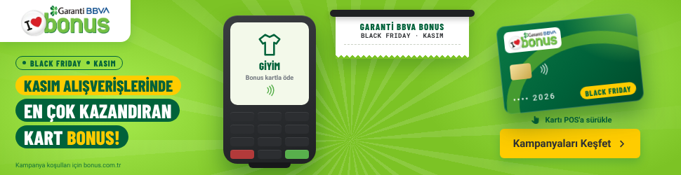 | 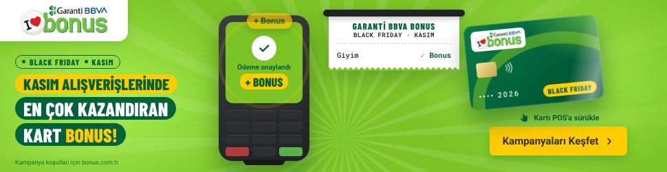 | 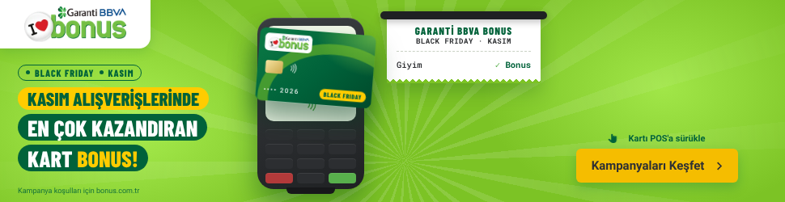 |

| Final – video alanı boş | Final – film oynuyor (test videosu) |
|---|---|
| 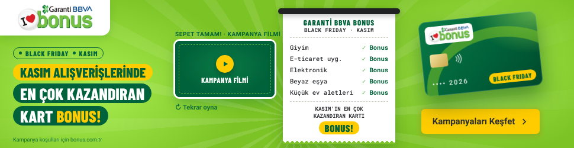 | 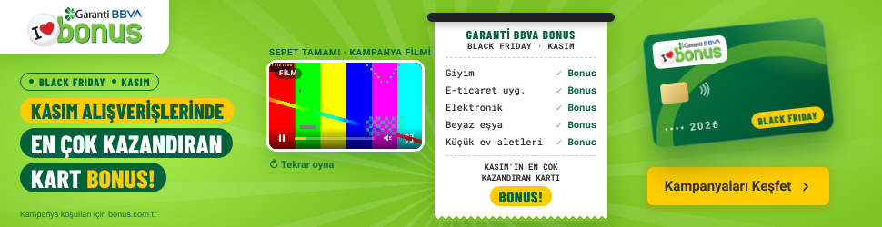 |

**Fikir:** Black Friday'de her ödeme Bonus kazandırır. Ortada bir POS cihazı, yanında fiş yazıcısı; sağda Bonus kartı.
1. POS ekranında sıradaki kategori görünür (Giyim → E-ticaret → Elektronik → Beyaz eşya → Küçük ev aletleri).
2. Kullanıcı kartı **sürükleyip POS'a bırakır** (ya da karta tıklar / Enter): temassız ödeme dalgaları, "Okunuyor…", ardından "Ödeme onaylandı · + BONUS".
3. Her ödemede fişe yeni satır basılır: "Giyim ✓ Bonus" …
4. 5 ödeme bitince fiş "KASIM'IN EN ÇOK KAZANDIRAN KARTI · BONUS!" toplamıyla tamamlanır, POS kenara çekilir ve yerine **küçük video alanı (16:9, 168×95)** açılır; CTA nabız atar.

**Etkileşim:** Sürükle-bırak (fare ve dokunmatik), karta tıklama, klavye (Tab → kart → Enter). Kullanıcı etkileşmezse kart kendiliğinden okutulur; yarıda bırakırsa 6 sn sonra devam eder; 30 sn içinde finale ulaşır. Kart ve video alanı tıklama çıkışını tetiklemez, banner'ın geri kalanı `clickTag` / `Enabler.exit` ile çıkar. "Tekrar oyna" baştan başlatır.

**Video:** Dosyanın başındaki `VIDEO_URL` (MP4, H.264, 16:9) doluysa final karesinde film sessiz başlar; oynat/duraklat, sarma, ses, tam ekran kontrolleri vardır. Boşken "Kampanya filmi" yer tutucusu görünür.

---

# Konsept 5: "Black Friday Vitrini" (fotoğraf-gerçekçi)

Teslim dosyası: `vitrin/index.html` (tek dosya, ~190 KB; görseller gömülü). Kaynak: `src/vitrin.html`, görseller `assets/vitrin/`.

| Kepenk kapalı | Kepenk kaldırılıyor | Işıklar yanıyor |
|---|---|---|
| 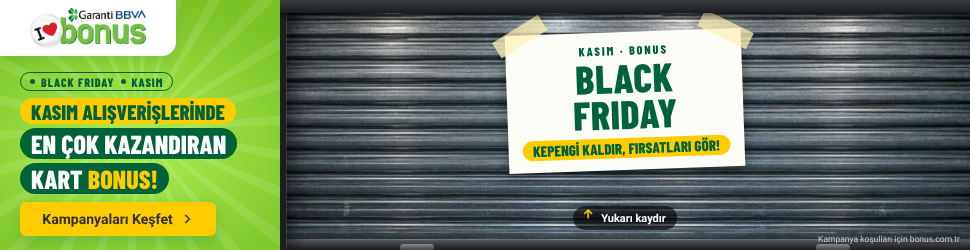 | 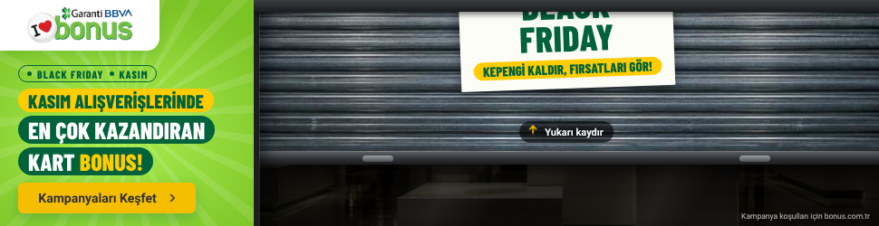 | 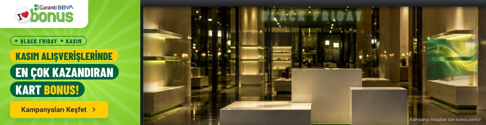 |

| Vitrin açık | Ürün üzerine gelme | Film TV ekranında (test videosu) |
|---|---|---|
| 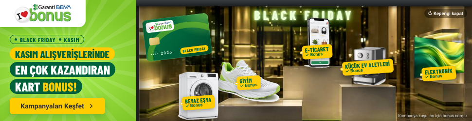 | 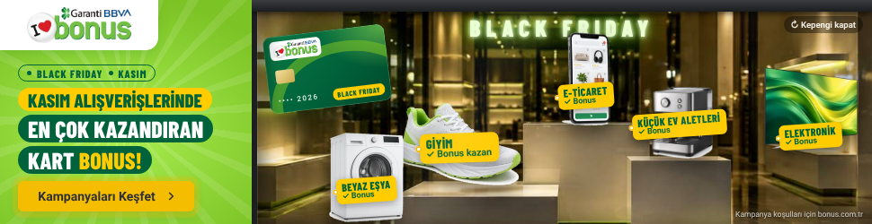 | 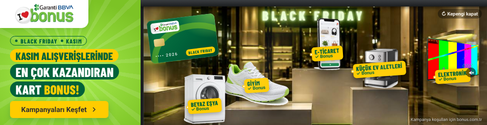 |

**Fikir:** Gece, kepengi kapalı bir mağaza vitrini. Kepengin üzerinde bantlı "BLACK FRIDAY – Kepengi kaldır, fırsatları gör!" afişi. Kullanıcı kepengi yukarı sürükler (ya da tıklar / fare tekerleği / ↑ tuşu); kepenk toplanır, mağazanın ışıkları titreyerek yanar, "BLACK FRIDAY" neon tabelası açılır, ürünler podyumlara yerleşir ve her birinin üzerinde Bonus etiketi belirir: Elektronik (TV), Beyaz eşya (çamaşır makinesi), Giyim (spor ayakkabı), E-ticaret (telefonda alışveriş uygulaması), Küçük ev aletleri (espresso makinesi). Son olarak Bonus kartı vitrine süzülür, CTA nabız atar.

**Etkileşim:** Kepengi sürükleme (fare + dokunmatik), tıklama, tekerlek, klavye. Kullanıcı dokunmazsa kepenk 3,2 sn sonra kendiliğinden açılır. Ürünlerin üzerine gelince ürün öne çıkar, etiket "Bonus kazan" olarak genişler. "Kepengi kapat" ile baştan oynar. Kepenk ve TV dışındaki her yer tıklama çıkışına gider (`clickTag` / `Enabler.exit`).

**Kampanya filmi:** `VIDEO_URL`'e MP4 adresi yazılırsa film vitrindeki **TV'nin ekranında**, ekranın perspektifine oturtulmuş olarak sessiz oynar; TV'ye tıklamak sesi açar/kapatır.

**Görseller:** Mağaza içi, kepenk ve 5 ürün yapay zekâ ile fotoğraf-gerçekçi üretildi (Figma AI, "Bonus Black Friday – Vitrin Masthead Görselleri" dosyası); markasız/logosuzdur. Ürünlerin fonu temizlenip WebP'ye, sahneler JPEG'e sıkıştırıldı (toplam ~110 KB). Gerçek ürün/kampanya fotoğrafları gelirse `assets/vitrin/` içindeki dosyalar aynı adlarla değiştirilip `node build.js` çalıştırılır. Not: Google Ads HTML5 sınırı 150 KB'tır; bu konsept masthead / rich media (DV360, YouTube Masthead vb.) ağırlık sınırlarına göre hazırlanmıştır.
