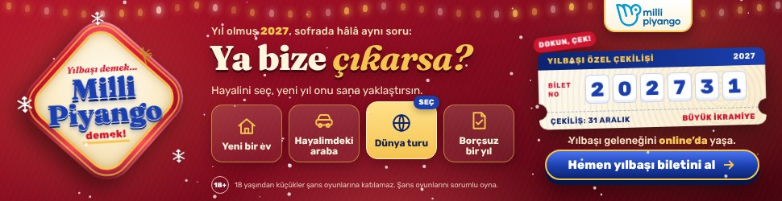
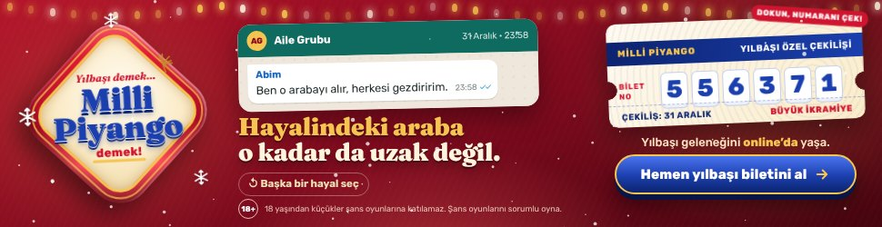

# Milli Piyango – Yılbaşı 2027 İnteraktif Masthead (970 × 250)

**Dosya:** `milli-piyango/970x250/index.html` (tek dosya, satır içi CSS + JS, görsel dosyası yok, ~27 KB)

Brief'teki üç kreatif fikir tek bir alanda birleşir: **Badge** ("Yılbaşı demek… Milli Piyango demek!"), **Yıl Olmuş 2027 / Ya Çıkarsa?** aile grubu sohbeti ve **kişiselleştirilmiş hayal** mesajı ("Hayal ettiğin şey o kadar da uzak değil"). Ana mesaj ("Yılbaşı geleneğini online'da yaşa.") ve CTA ("Hemen yılbaşı biletini al") her an görünür.

| Açılış | Hayalini seç | Seçim sonrası |
|---|---|---|
|  |  |  |

| Bilete dokunma | DCO (`?dream=araba`) | Kapanış |
|---|---|---|
|  |  |  |

## Kurgu

1. **Açılış (0–2,6 sn):** Kırmızı kadife zemin, üstte yılbaşı ışık zinciri, yağan kar. Yuvarlatılmış elmas rozet (V3 badge'i) konfetiyle ortada belirir, ardından sola yerleşir.
2. **"Ya bize çıkarsa?" (2,6 sn →):** Ortada *"Yıl olmuş 2027, sofrada hâlâ aynı soru: Ya bize çıkarsa?"* başlığı ve dört hayal kartı: **Yeni bir ev · Hayalimdeki araba · Dünya turu · Borçsuz bir yıl**. Kartlar sırayla parlayarak "SEÇ" ipucu verir.
3. **Seçim:** Kullanıcı bir hayal seçtiğinde ortada aile grubunda "yazıyor…" animasyonu, ardından aile üyesinin mesajı gelir (Annem: "Bize çıkarsa ben önce bir ev alırım." / Babam: "Önce bütün borçları kapatalım." / Elif: "Ben direkt dünya turuna çıkıyorum!" / Abim: "Ben o arabayı alır, herkesi gezdiririm.") ve kişisel başlık yazılır: **"Hayalindeki ev o kadar da uzak değil."** Aynı anda sağdaki yılbaşı biletinin numaraları çekiliş gibi döner, konfeti patlar.
4. **Yılbaşı bileti:** Sağda bilet, "DOKUN, NUMARANI ÇEK!" ipucuyla oyunlaştırılmış alan. Dokununca 6 haneli numara döner, CTA nabız atar.
5. **Otomatik demo:** Kullanıcı etkileşmezse dört hayal sırayla (her biri 3,6 sn) gösterilir, sonra seçim ekranına dönüp CTA vurgulanır. Fare bannerın üzerine gelince demo durur, kontrol kullanıcıya geçer. Kar efekti 30 sn sonra durur (Google Ads / DV360 kuralı).

## Dinamik kreatif (DCO) / data kullanımı

Brief'teki "kullanıcının incelediği araç, hayal ettiği yaşam tarzı" fikri için masthead, açılışta doğrudan ilgili hayalle başlayabilir:

| Sinyal (mecra datası / segment) | Parametre | Açılan mesaj |
|---|---|---|
| Araç satın alma ilgisi, otomobil içerikleri | `dream=araba` | "Hayalindeki araba o kadar da uzak değil." |
| Ev / konut ilgisi, emlak, kredi | `dream=ev` | "Hayalindeki ev o kadar da uzak değil." |
| Seyahat, lifestyle | `dream=tur` | "O dünya turu o kadar da uzak değil." |
| Bankacılık, finans, yatırım, kripto | `dream=borc` | "Borçsuz bir yıl o kadar da uzak değil." |

Parametre URL ile (`index.html?dream=araba`) ya da sunucu makrosuyla `window.MP_DREAM = 'araba'` olarak verilir. Tıklamalar parametresiz olarak doğrudan ana sayfaya yönlenir.

## Teknik

- **Sayfa:** Masthead beyaz zemin üzerinde, sayfanın tam ortasında (yatay ve dikey) görüntülenir.
- **Tıklama:** Arka plan ve CTA çıkış yapar; `window.clickTag` (Google Ads / CM360) veya `Enabler.exit` (Studio) varsa onlar kullanılır, yoksa doğrudan ana sayfa (`CFG.exitUrl`, UTM/parametre yok) açılır. Hayal kartları, bilet ve "Başka bir hayal seç" kontroldür, çıkış tetiklemez.
- **Ayarlar:** Metinler, aile mesajları, çekiliş tarihi ve çıkış adresi `index.html` içindeki `CFG` nesnesindedir.
- **Tipografi:** Google Fonts – *Fraunces* (rozet ve başlıklar), *Rubik* (metin). Türkçe karakter desteği tam.
- **Erişilebilirlik:** Tüm kontroller `button`, klavye ile gezilebilir, `aria-live` ile sonuç okunur; `prefers-reduced-motion` açıksa kar/konfeti kapanır.
- **18+:** Yasal ibare ("18 yaşından küçükler şans oyunlarına katılamaz.") ve 18+ ikonu kalıcıdır. Yayın, yalnızca 18+ doğrulanmış/yaşa göre hedeflenen envanterde ve brief'teki içerik kategorilerinde (spor/futbol yorum, finans, yatırım, kripto, lifestyle) planlanmalıdır.

## Yayın öncesi kontrol

- Yasal ibare metni ve "Büyük İkramiye" tutarı (eklenecekse) Milli Piyango onayından geçmelidir; tutar bilinmediği için bannerda rakam yoktur.
- Çıkış adresi (`https://www.millipiyangoonline.com/`) kampanya ekibiyle teyit edilmelidir.
- Rozet, brief'teki V3 badge tasarımının kod ile yeniden çizimidir; nihai yayında onaylı badge görseli (PNG/SVG) ile değiştirilebilir.
