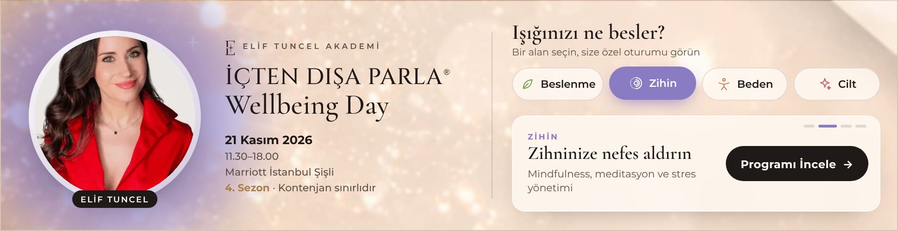
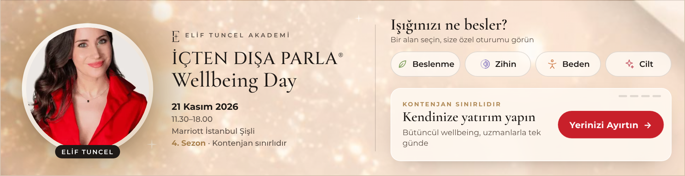
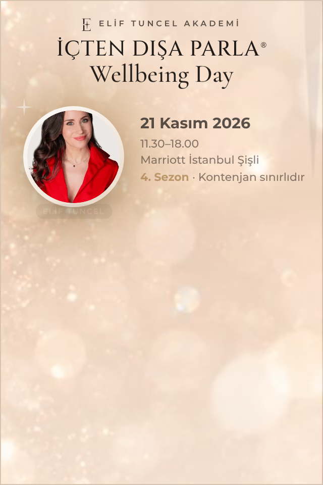
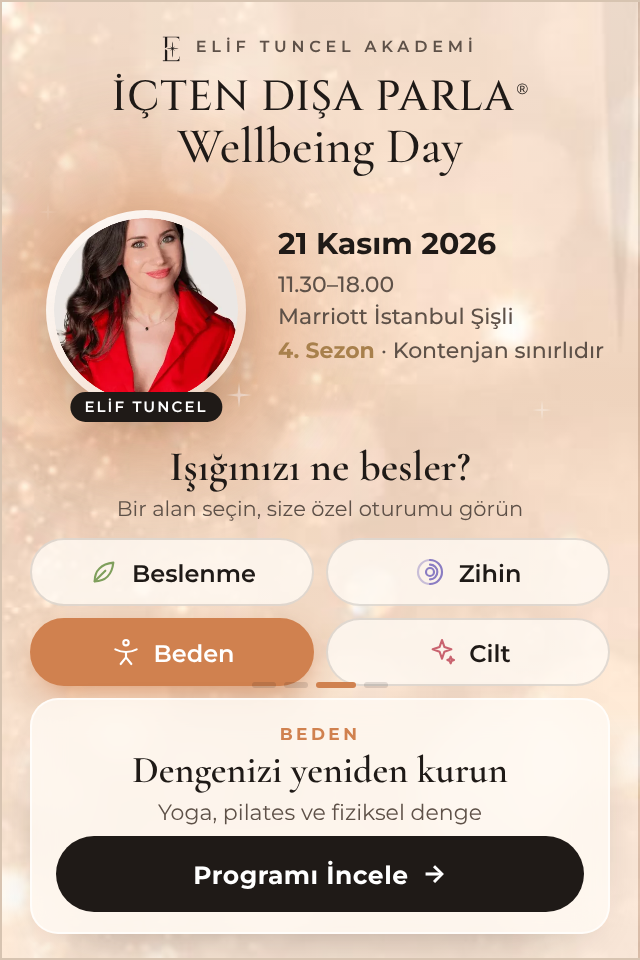
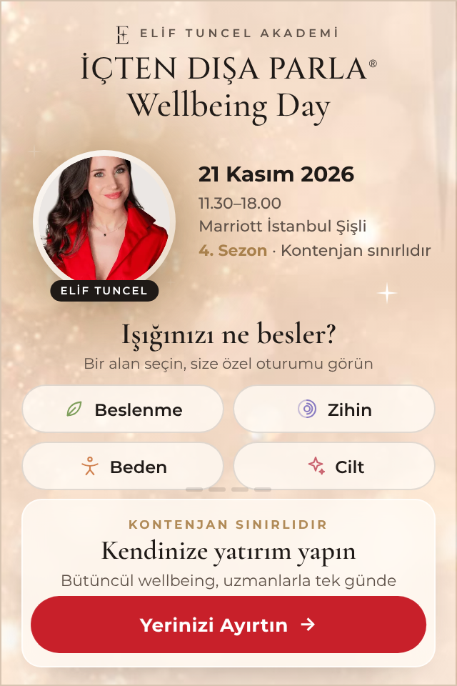

# İçten Dışa Parla · Wellbeing Day 2026 – Interaktif HTML5 Banner

Elif Tuncel Akademi'nin "İçten Dışa Parla Wellbeing Day 2026" programı için **seçim yaptıran (quiz tipi) interaktif display banner**.

| Boyut | Kullanım | Dosya | Paket |
|---|---|---|---|
| 970 × 250 | Billboard (masaüstü, premium display) | `dist/970x250/index.html` | `dist/zip/wellbeing-day-2026-970x250.zip` |
| 320 × 480 | Mobil interstitial / in-app | `dist/320x480/index.html` | `dist/zip/wellbeing-day-2026-320x480.zip` |

İkisini birlikte görmek için: **`preview.html`** – bannerlar içine gömülüdür, dosya tek başına indirilip açılabilir (yeniden oynat düğmeli).

**Etkinlik:** 21 Kasım 2026 · 11.30–18.00 · Marriott İstanbul Şişli · 4. Sezon · Kontenjan sınırlıdır.

**Görseller:** Resmi afişten (`assets/source/afis.webp`) alındı: Elif Tuncel portresi, şampanya ışıltılı fon ve Elif Tuncel Akademi "E" logosu → `assets/`. Bannerlara base64 olarak gömülür (harici istek yok).

| 970 × 250 – seçim | 970 × 250 – kapanış |
|---|---|
|  |  |

| 320 × 480 – açılış | 320 × 480 – otomatik akış | 320 × 480 – kapanış |
|---|---|---|
|  |  |  |

## Kurgu – "Bugün ışığını ne besler?"

1. **Açılış (~2,6 sn):** Afişteki ışıltılı fon üzerinde Elif Tuncel portresi ışık halesiyle belirir; *İÇTEN DIŞA PARLA® Wellbeing Day* başlığı, tarih, saat, mekân ve "4. Sezon · Kontenjan sınırlıdır" gelir.
2. **Soru:** Kullanıcıya dört alan sunulur: **Beslenme · Zihin · Beden · Cilt**.
3. **Seçim:** Bir alana dokununca portrenin arkasındaki ışık o alanın rengine döner, panelde o alana ait oturum mesajı gösterilir (ör. *Zihin → "Zihninize nefes aldırın" – Mindfulness, meditasyon ve stres yönetimi*).
4. **Etkileşim yoksa:** Banner kendi kendine dört alanı sırayla "dokunarak" gösterir (tıklama dalgası efekti ile etkileşimli olduğunu anlatır), ardından kapanış karesinde *"Kendinize yatırım yapın"* + nabız efektli kırmızı **Yerinizi Ayırtın** CTA'sı ile durur.
5. Tüm döngüsel animasyonlar 30 sn'de durur (Google Ads / IAB kuralı).

## Neden bu format? (trafik kalitesi)

- Seçim yapan kullanıcı, tıklamadan önce ilgisini **beyan etmiş** olur → siteye gelen trafik daha nitelikli.
- Çıkış bağlantısı seçilen alanı UTM'e yazar: `utm_content=<boyut>_<alan>` (ör. `970x250_zihin`). GA4'te hangi ilgi alanının daha çok kayıt getirdiği ayrıştırılabilir; kreatif/hedefleme optimizasyonu buna göre yapılır.
- Studio/DV360'ta `Enabler.counter('secim_<alan>')` ile her seçim ayrıca etkileşim olarak sayılır.

## Etkileşim ve teknik

- Alan seçimleri reklam çıkışını tetiklemez; **CTA** ve bannerın geri kalanı tıklanabilir.
- Fare banner üzerinde hareket edince otomatik akış durur, ayrılınca devam eder. Klavye ile chip'ler ve CTA odaklanabilir.
- `window.clickTag` varsa o kullanılır (Google Ads / CM360), `Enabler` varsa `Enabler.exit`, ikisi de yoksa UTM'li program sayfası açılır.
- Tek dosya, satır içi CSS/JS, görseller gömülü – 970×250 ~54 KB, 320×480 ~49 KB (150 KB sınırının altında).
- Fontlar (afişe yakın): Google Fonts *Cinzel* (başlık), *Cormorant Garamond* (Wellbeing Day / başlıklar), *Montserrat* (metin); yüklenemezse Georgia / Arial'a düşer.
- `prefers-reduced-motion` desteklenir; `ad.size` meta etiketi mevcuttur.

## Düzenleme

Bütün metinler, alanlar, renkler, süreler ve hedef URL: **`src/data.js`**.
Görsel dosyaları `data.images` altında; değiştirilirse `node build.js` yeniden gömer.

```bash
node build.js                               # dist/ + zip + preview.html
NODE_PATH=$(npm root -g) node capture.js    # (isteğe bağlı) screens/ ekran görüntüleri – Playwright gerekir
```

> Not: Alan açıklamaları programın genel temalarından yazıldı (bu ortamdan eliftuncel.com'a erişilemedi; görseller bu yüzden afişten alındı). Yayına almadan önce gerçek oturum başlıklarıyla eşleştirilmesi önerilir.
